\newpage
# Lời cảm ơn và tuyên bố sử dụng AI {.unnumbered}

**Lời cảm ơn.** Lời đầu tiên em xin gửi lời cảm ơn đến Ban tổ chức của chương trình Samsung Innovation Campus 2026 đã tạo điều kiện cho em được học tập, trau dồi kiến thức và kỹ năng. Em cũng xin bày tỏ lòng biết ơn chân thành và sâu sắc đến Thạc sĩ Trần Mạnh Tường, giảng viên học phần Trí tuệ Nhân tạo Ứng dụng & Khoa học Dữ liệu của chương trình Samsung Innovation Campus 2026, đã tận tình giảng dạy, định hướng và hướng dẫn phương pháp Design Thinking, quy trình khai phá dữ liệu CRISP-DM, cũng như nền tảng lý thuyết và cách vận dụng các mô hình học máy và kỹ thuật giải thích mô hình được sử dụng xuyên suốt trong đồ án.

Đồng thời, em xin trân trọng cảm ơn kho dữ liệu học máy **UCI Machine Learning Repository** cùng nhóm tác giả **Valentim Realinho, Jorge Machado, Luís Baptista và M. V. Martins** (Viện Bách khoa Portalegre, Bồ Đào Nha) đã thu thập, chuẩn hóa và công bố công khai bộ dữ liệu *Predict Students' Dropout and Academic Success* theo giấy phép mở (CC BY 4.0) để phục vụ mục đích nghiên cứu khoa học và giáo dục.

**Tuyên bố sử dụng AI.** Tuân thủ nguyên tắc minh bạch và liêm chính học thuật, em xin tuyên bố có sử dụng các công cụ Trí tuệ Nhân tạo tạo sinh (Generative AI) với vai trò trợ lý hỗ trợ trong quá trình lập đề cương, tra cứu nguồn tham khảo, rà soát cú pháp mã nguồn và biên tập báo cáo. Cụ thể, phạm vi sử dụng từng công cụ như sau:

- **Claude Sonnet 5.5:** Hỗ trợ xây dựng và triển khai đề cương chi tiết ban đầu (`docs/OUTLINE_BAO_CAO_CUOI_KHOA.md`) và bản đề cương hoàn thiện nguồn trích dẫn; gợi ý cấu trúc tổ chức mã nguồn, hỗ trợ kiểm tra và sửa lỗi cú pháp trong mã nguồn phân tích, ứng dụng và định dạng Quarto; đồng thời hỗ trợ rà soát, biên tập và hoàn thiện câu chữ cho bản báo cáo cuối cùng (`Report_26_11_6.qmd`).
- **Perplexity:** Hỗ trợ tìm kiếm, tra cứu và gợi ý các nguồn tài liệu học thuật, bài báo khoa học, tài liệu chuẩn thư viện và khung đạo đức AI có liên quan để bổ sung, chuẩn hóa trích dẫn vào đề cương (`docs/OUTLINE_BAO_CAO_CUOI_KHOA.md`) cùng các tệp tài liệu tham khảo (`references.bib`).
- **ChatGPT 6 Luna và Gemini 4 Argon:** Hỗ trợ triển khai và mở rộng bản thảo nội dung các chương/mục của bài báo cáo dựa trên khung đề cương chi tiết (`docs/OUTLINE_BAO_CAO_CUOI_KHOA.md`).

Các công cụ AI nêu trên không thay thế việc lựa chọn dữ liệu, thiết kế thí nghiệm, thực hiện quy trình phân tích trong mã nguồn, kiểm tra kết quả thực nghiệm và chịu trách nhiệm học thuật của em. Em đã trực tiếp đối chiếu và xác minh toàn bộ nội dung, số liệu, bảng biểu, hình ảnh và kết luận trong báo cáo với kết quả thực tế từ notebook (`notebooks/SIC_UCI_DropStudent_out.ipynb`), module tiện ích (`dropout_utils.py`), ứng dụng (`app.py`) và các tệp kết quả của dự án.

# Tóm tắt {.unnumbered}

Đồ án xây dựng nguyên mẫu hệ thống cảnh báo sớm sinh viên có nguy cơ nghỉ học. Điểm xuất phát là một câu hỏi về thời điểm: cảnh báo chỉ hữu ích khi được phát ra lúc nhà trường còn thời gian hỗ trợ, và chỉ được dùng những thông tin đã biết tại thời điểm đó. Vì vậy báo cáo định nghĩa bốn kịch bản thông tin S0 (lúc nhập học), S1 (hết học kỳ 1, không gồm hai biến tài chính chưa rõ thời điểm đo), S1F (S1 cộng tài chính) và S2 (hết học kỳ 2), rồi chọn S1 làm kịch bản triển khai. Trên bộ dữ liệu UCI gồm 4.424 hồ sơ, 3.630 hồ sơ có nhãn cuối cùng được dùng để phát triển và đánh giá mô hình; 794 hồ sơ `Enrolled` được chấm điểm riêng. Tập kiểm thử độc lập gồm 726 hồ sơ. Mô hình Logistic Regression được chọn theo quy tắc cân nhắc hiệu năng, độ trễ và kích thước; mô hình đạt ROC-AUC 0,931 và Average Precision 0,916 trên tập kiểm thử. Ngưỡng 0,19 được chọn bằng dự báo ngoài fold trên tập phát triển theo hàm lợi ích ròng giả định; tại ngưỡng này, Recall đạt 94,0% và Precision 66,4%, đổi lại 55,4% hồ sơ bị gắn cờ. Nguyên mẫu Streamlit hiển thị xác suất, ba mức ưu tiên, giải thích SHAP, mô phỏng what-if và chấm điểm CSV. Kết quả là minh chứng kỹ thuật trên dữ liệu lịch sử Bồ Đào Nha, chưa phải bằng chứng rằng can thiệp sẽ làm giảm nghỉ học; trước khi áp dụng cần kiểm định tại cơ sở giáo dục mục tiêu, xác thực giả định chi phí và thiết lập giám sát công bằng, quyền riêng tư.

**Từ khóa:** cảnh báo sớm; nghỉ học; học máy; giáo dục; SHAP; hỗ trợ quyết định.

# Danh mục từ viết tắt {.unnumbered}

| Từ viết tắt | Diễn giải |
|---|---|
| AI | Trí tuệ nhân tạo |
| AUC / ROC-AUC | Diện tích dưới đường cong / diện tích dưới đường ROC |
| AP (PR-AUC) | Average Precision, tóm tắt đường Precision–Recall |
| CRISP-DM | Cross-Industry Standard Process for Data Mining |
| CV | Cross-validation, kiểm định chéo |
| CVHT | Cố vấn học tập |
| Dev / Test | Tập phát triển (dùng chọn mô hình, ngưỡng) / tập kiểm thử giữ riêng |
| EDA | Phân tích khám phá dữ liệu |
| FN, FP, TN, TP | Âm tính giả, dương tính giả, âm tính thật, dương tính thật |
| FPR | Tỷ lệ dương tính giả |
| IQR | Khoảng tứ phân vị |
| LMS | Hệ thống quản lý học tập |
| LR, RF, XGB | Logistic Regression, Random Forest, XGBoost |
| NB, ROI | Lợi ích ròng, tỷ suất lợi ích trên chi phí can thiệp |
| OOF | Out-of-fold, dự báo cho các mẫu không tham gia huấn luyện fold đó |
| S0, S1, S1F, S2 | Các kịch bản thông tin theo thời điểm dự báo (xem [Mục 3.2](#sec-scenarios)) |
| SHAP | SHapley Additive exPlanations |
| SIS | Hệ thống thông tin sinh viên |
| SMART | Cụ thể, đo lường được, khả thi, phù hợp, có thời hạn |
| XAI | Trí tuệ nhân tạo có thể giải thích |

: Danh mục từ viết tắt {#tbl-abbreviations}

# Giới thiệu và xác định bài toán {#sec-ch1}

## Bối cảnh và vấn đề {#sec-context}

Nghỉ học giữa chừng là một trong những kết cục bất lợi nhất của giáo dục đại học: người học mất thời gian và chi phí đã đầu tư, còn nhà trường mất nguồn lực đào tạo và uy tín về chất lượng. Các nghiên cứu về nghỉ học đại học thường nhìn quyết định rời trường như kết quả của sự tương tác giữa sinh viên và môi trường học tập, trong đó mức độ hòa nhập về học thuật và xã hội đóng vai trò quan trọng [@tinto1975]. Hệ quả thực tiễn là dấu hiệu khó khăn thường xuất hiện sớm trong chính các hồ sơ mà nhà trường đã lưu: ngành đăng ký, điểm đầu vào, số môn đăng ký và số môn đạt trong học kỳ đầu.

Từ hướng tiếp cận phân tích học tập (learning analytics), nhiều hệ thống cảnh báo sớm đã được xây dựng để dùng dữ liệu đó nhằm nhận diện sinh viên cần chú ý và điều phối hỗ trợ; hai ví dụ thường được trích dẫn là Course Signals tại Purdue [@arnold2012] và sáng kiến Open Academic Analytics [@jayaprakash2014]. Bộ dữ liệu công khai *Predict Students' Dropout and Academic Success* được xây dựng từ hồ sơ của một cơ sở giáo dục đại học tại Bồ Đào Nha [@realinho2021; @realinho2022]. Trong 3.630 hồ sơ có nhãn cuối cùng của bộ dữ liệu này, 1.421 hồ sơ là `Dropout` (39,1%); đây là tỷ lệ của bộ dữ liệu nghiên cứu, không phải ước lượng đại diện cho mọi trường đại học.

Có một khoảng cách giữa việc "xây được mô hình có AUC cao" và việc "có một công cụ mà cố vấn học tập dùng được". Đồ án này xử lý bốn khoảng cách đó:

1. **Thời điểm.** Mô hình có thể đạt AUC cao hơn nếu dùng cả kết quả học kỳ 2 hoặc các biến được ghi nhận muộn, nhưng khi đó cảnh báo đến quá trễ hoặc dùng thông tin chưa có lúc cần dự báo. Cần chọn rõ mốc cảnh báo và chỉ dùng thông tin có trước mốc đó ([Mục 3.2](#sec-scenarios)).
2. **Giải thích.** Một danh sách điểm số không có lý do dễ tạo thêm việc cho cố vấn và làm giảm niềm tin. Cần chỉ ra yếu tố nào đẩy điểm rủi ro lên hoặc xuống ở từng hồ sơ.
3. **Ngưỡng và chi phí.** Ngưỡng 0,50 là quy ước, không phải lựa chọn gắn với năng lực tư vấn của nhà trường. Bỏ sót một sinh viên có nguy cơ và gọi nhầm một sinh viên ổn định có hậu quả khác nhau, nên ngưỡng cần được chọn có chủ đích.
4. **Công bằng và rủi ro sử dụng.** Dữ liệu chứa giới tính, tuổi, học bổng; một điểm rủi ro có thể bị dùng sai thành nhãn gán cho cá nhân. Cần kiểm tra chênh lệch giữa các nhóm và đặt công cụ vào quy trình có con người quyết định.

Quy trình thủ công khiến CVHT khó sắp xếp thứ tự xem xét khi số hồ sơ lớn; cảnh báo bỏ sót lại có thể khiến sinh viên không nhận được liên hệ kịp thời. Vì vậy, bài toán được xác định là **xếp hạng và phân tầng hồ sơ cần CVHT xem xét sau khi có kết quả học kỳ 1**, kèm theo lý do mô hình đưa ra điểm rủi ro.

## Phát biểu bài toán và câu hỏi nghiên cứu {#sec-problem}

Với mỗi hồ sơ sinh viên $i$, gọi $\mathbf{x}_i$ là vector các thông tin đã biết đến hết học kỳ 1 (thông tin đầu vào, kết quả học kỳ 1 và các biến tỷ lệ dẫn xuất từ chúng) và $y_i \in \{0,1\}$ là nhãn cuối cùng, với $y_i=1$ nếu sinh viên `Dropout` và $y_i=0$ nếu `Graduate`. Mô hình ước lượng
$$
\hat p_i = \hat P(y_i = 1 \mid \mathbf{x}_i),
$$
sau đó hệ thống (i) xếp hạng các hồ sơ theo $\hat p_i$, (ii) phân hồ sơ vào ba mức Xanh/Vàng/Đỏ bằng hai ngưỡng, và (iii) hiển thị lý do bằng giá trị SHAP. Hồ sơ `Enrolled` không có $y_i$ nên chỉ được chấm điểm $\hat p_i$, không dùng để huấn luyện hay đo hiệu năng.

Đồ án trả lời bốn câu hỏi nghiên cứu, mỗi câu gắn với một phần của báo cáo:

| Mã | Câu hỏi | Phần trả lời |
|---|---|---|
| RQ1 | Nên dự báo tại thời điểm nào, và dùng những biến nào, để cảnh báo vừa đủ sớm vừa không rò rỉ thông tin? | [Mục 3.2](#sec-scenarios), [Mục 4.1](#sec-scenario-eval) |
| RQ2 | Trong ba họ mô hình bảng phổ biến (LR, RF, XGB), mô hình nào nên được chọn khi xét cả hiệu năng, quá khớp, độ trễ và khả năng giải thích? | [Mục 4.2](#sec-baselines)–[Mục 4.4](#sec-selection) |
| RQ3 | Ngưỡng cảnh báo nên đặt ở đâu khi bỏ sót và báo nhầm có chi phí khác nhau, và đánh đổi đó trông như thế nào trên tập kiểm thử? | [Mục 1.6](#sec-benefit), [Mục 5.1](#sec-test-perf)–[Mục 5.2](#sec-thresholds) |
| RQ4 | Điểm rủi ro được giải thích, kiểm tra công bằng và đặt vào quy trình vận hành ra sao để hỗ trợ chứ không thay thế quyết định của con người? | [Mục 5.3](#sec-shap-eval)–[Mục 5.4](#sec-fairness-eval), [Chương 6](#sec-ch6) |

: Câu hỏi nghiên cứu và vị trí trả lời {#tbl-rq}

## Người dùng và nhu cầu {#sec-users}

Người dùng trực tiếp là CVHT hoặc chuyên viên hỗ trợ sinh viên; sinh viên năm nhất là người thụ hưởng. CVHT cần biết hồ sơ nào nên xem trước, yếu tố nào đóng góp vào dự báo, và có thể đề xuất bước hỗ trợ phù hợp. Sinh viên cần được tiếp cận hỗ trợ tôn trọng, kín đáo và không bị xem như một nhãn rủi ro cố định. Ban đào tạo và bộ phận công tác sinh viên là các bên liên quan về dữ liệu và quy trình, còn người quản trị hệ thống chịu trách nhiệm vận hành mô hình.

| Nhu cầu của CVHT | Quyết định thiết kế |
|---|---|
| Ưu tiên hồ sơ khi nguồn lực có hạn | Xác suất và ba mức Xanh/Vàng/Đỏ |
| Hiểu căn cứ của cảnh báo | Biểu đồ giải thích cục bộ SHAP |
| Xem tác động giả định của thay đổi đầu vào | Mô phỏng what-if có chú thích không mang ý nghĩa nhân quả |
| Xử lý nhiều hồ sơ | Tải CSV, xếp hạng và xuất kết quả |

: Nhu cầu người dùng và quyết định thiết kế {#tbl-needs}

### Chân dung người dùng và bản đồ thấu cảm {#sec-persona}

CVHT thường phải xử lý hồ sơ từ nhiều hệ thống, cân nhắc thời gian liên hệ và phân biệt trường hợp cần can thiệp ngay với trường hợp chỉ cần theo dõi. Họ chịu hai áp lực trái chiều: sợ bỏ sót sinh viên cần giúp, nhưng cũng ngại một danh sách quá dài khiến mọi cảnh báo mất giá trị. Bản đồ thấu cảm dưới đây tóm tắt các góc nhìn đó và chuyển chúng thành hàm ý thiết kế cụ thể.

| Góc nhìn của CVHT | Nhu cầu hoặc áp lực | Hàm ý thiết kế |
|---|---|---|
| Thấy | Điểm và tình trạng học tập rời rạc; có hồ sơ vắng đánh giá | Gom dữ liệu và xếp hạng hồ sơ sau kỳ 1 |
| Nghĩ và cảm thấy | Lo bỏ sót trường hợp cần trợ giúp, đồng thời ngại danh sách cảnh báo quá rộng | Ưu tiên Recall nhưng công khai số hồ sơ bị gắn cờ và lý do |
| Khó khăn | Thiếu thời gian để rà soát thủ công từng hồ sơ | Cho phép lọc, xem giải thích và tải kết quả theo lô |
| Mong muốn | Biết nên bắt đầu cuộc trao đổi hỗ trợ từ đâu | Đưa ra gợi ý liên hệ, để CVHT xác minh hoàn cảnh trước khi hành động |

: Bản đồ thấu cảm và hàm ý thiết kế {#tbl-empathy}

## Phân loại bài toán và mục tiêu SMART {#sec-smart}

Đây là bài toán phân loại nhị phân có giám sát, được dùng theo hai hướng: khai phá các tín hiệu liên quan đến nghỉ học và hỗ trợ CVHT ưu tiên hồ sơ. Vì giá trị thực tế nằm ở thứ tự ưu tiên chứ không phải ở một nhãn cứng, báo cáo coi **xếp hạng** (đo bằng ROC-AUC và Average Precision) và **quyết định theo ngưỡng** (đo bằng Recall, Precision, tỷ lệ gắn cờ) là hai khía cạnh cần báo cáo tách bạch. Mục tiêu SMART của nguyên mẫu được cụ thể hóa như sau:

- **Cụ thể:** ước lượng nguy cơ `Dropout` sau khi có kết quả kỳ 1, dùng kịch bản S1 gồm 33 đặc trưng và chấm điểm riêng nhóm `Enrolled`.
- **Đo lường:** tham chiếu ROC-AUC từ 0,90 trở lên; đánh giá thêm Recall, Precision, Average Precision và tỷ lệ hồ sơ bị gắn cờ tại ngưỡng vận hành.
- **Khả thi:** so sánh ba mô hình bảng phổ biến trong pipeline tiền xử lý thống nhất; giải thích dự báo bằng SHAP.
- **Phù hợp:** đưa danh sách ưu tiên cho CVHT vào đầu kỳ 2, khi vẫn còn khả năng trao đổi và hỗ trợ.
- **Có thời hạn:** nguyên mẫu trả điểm cho một hồ sơ ngay sau khi nhập; benchmark notebook ghi nhận khoảng 0,013 ms/hồ sơ cho phần suy luận mô hình, chưa gồm giao diện và SHAP.

| Tiêu chí | Chỉ tiêu đặt ra | Kết quả ghi nhận | Nguồn |
|---|---|---|---|
| Phân biệt/xếp hạng | ROC-AUC $\ge$ 0,90 | 0,931 trên Test | @tbl-test-results |
| Phát hiện ca nghỉ học | Recall cao tại ngưỡng vận hành | 94,0% tại ngưỡng 0,19 | @tbl-test-results |
| Khối lượng rà soát | Công khai tỷ lệ gắn cờ | 55,4% hồ sơ Test bị gắn cờ | @tbl-test-results |
| Tốc độ | Trả điểm tức thì | $\approx$ 0,013 ms/hồ sơ (chỉ mô hình) | @tbl-model-cost |
| Giải thích | Có lý do cho từng dự báo | SHAP cục bộ trong ứng dụng | [Mục 6.1](#sec-app) |

: Đối chiếu mục tiêu SMART với kết quả {#tbl-smart}

Các chỉ tiêu này là tiêu chí thiết kế và đánh giá kỹ thuật của đồ án. Chúng không phải cam kết rằng hệ thống sẽ đạt cùng hiệu năng tại một trường khác.

## Mục tiêu, phạm vi và đóng góp {#sec-scope}

Mục tiêu là xây dựng nguyên mẫu dự báo nguy cơ `Dropout` từ các biến có thể biết đến hết kỳ 1, đánh giá trên tập kiểm thử giữ riêng và cung cấp giải thích cho từng dự báo. Hệ thống dự kiến chạy cục bộ bằng Streamlit; độ trễ trung bình khoảng 0,013 ms/hồ sơ được đo trên máy phát triển, không bao gồm giao diện, nạp dữ liệu hoặc tính SHAP.

| Trong phạm vi | Ngoài phạm vi |
|---|---|
| Dự báo nguy cơ `Dropout` từ thông tin đến hết kỳ 1 | Quyết định kỷ luật, thôi học hoặc cấp/cắt học bổng |
| Xếp hạng, phân tầng và giải thích để CVHT ưu tiên hồ sơ | Khẳng định quan hệ nhân quả giữa một biến và việc nghỉ học |
| Nguyên mẫu chạy cục bộ trên dữ liệu lịch sử | Triển khai trực tiếp cho sinh viên tại Việt Nam khi chưa hiệu chỉnh và đánh giá tại chỗ |
| Phân tích độ nhạy theo thời điểm (S0, S1F, S2) | Kết nối SIS, xác thực người dùng, giám sát drift tự động |

: Phạm vi của đồ án {#tbl-scope}

Đóng góp của đồ án gồm: (i) định nghĩa và so sánh bốn kịch bản thông tin theo thời điểm, giải thích rõ vì sao chọn S1; (ii) quy trình tiền xử lý chống rò rỉ, với mọi bước fit nằm trong fold huấn luyện; (iii) quy tắc chọn mô hình có tính đến quá khớp, độ trễ và kích thước thay vì chỉ lấy AUC cao nhất; (iv) cách chọn ngưỡng dựa trên dự báo ngoài fold và hàm lợi ích ròng, kèm phân tầng ba mức; (v) giải thích SHAP, phân tích công bằng theo nhóm và nguyên mẫu Streamlit có kèm giới hạn sử dụng.

## Mô hình lợi ích và giả định {#sec-benefit}

Để chọn ngưỡng có chủ đích, đồ án dùng một mô hình lợi ích tối giản với ba tham số được chuẩn hóa theo cùng một đơn vị: tổn thất khi mất một sinh viên $L=1$, chi phí một lượt can thiệp (tư vấn) $C=0{,}05$, và xác suất can thiệp thành công giả định $S=0{,}30$. Khi một hồ sơ bị gắn cờ, nhà trường trả chi phí $C$; nếu hồ sơ đó thật sự là ca nghỉ học và can thiệp thành công (xác suất $S$), nhà trường tránh được tổn thất $L$. Lợi ích ròng và tỷ suất trên chi phí được tính theo số dương tính thật (TP) và dương tính giả (FP):

$$
NB = TP\,(SL-C)-FP\,C, \qquad ROI=\frac{NB}{(TP+FP)\,C}.
$$

Viết lại $NB = TP\cdot SL - (TP+FP)\,C$ cho thấy ý nghĩa: lợi ích kỳ vọng từ các ca nghỉ học được cứu, trừ tổng chi phí tư vấn cho mọi hồ sơ bị gắn cờ. Đây là giả định mô phỏng, không phải số liệu tài chính quan sát của trường; phân tích chi phí bất đối xứng là một cách đặt bài toán lựa chọn quyết định [@elkan2001].

**Ngưỡng lý thuyết.** Với một hồ sơ có xác suất nghỉ học $p$, việc gắn cờ có lợi kỳ vọng dương khi $p\,S\,L > C$, tức
$$
p > t_{\text{lý thuyết}} = \frac{C}{S\,L} = \frac{0{,}05}{0{,}30\times 1} \approx 0{,}167,
$$
với điều kiện xác suất mô hình được hiệu chỉnh tốt. Ngưỡng 0,19 chọn bằng thực nghiệm trên dự báo ngoài fold ([Mục 5.2](#sec-thresholds)) cùng bậc độ lớn với giá trị này; sự chênh nhỏ có thể đến từ việc xác suất chưa hiệu chỉnh hoàn toàn và từ nhiễu mẫu. Công thức cũng cho thấy ngưỡng nhạy với giả định: $S$ thấp hơn hoặc $C$ cao hơn sẽ đẩy ngưỡng lên (@tbl-threshold-sens ở [Mục 5.2](#sec-thresholds)).

**Ví dụ tính tay trên tập kiểm thử.** Từ các ma trận nhầm lẫn ở @fig-cm ([Mục 5.1](#sec-test-perf)), lợi ích ròng được tính lại cho hai ngưỡng như sau (chỉ để minh họa; ngưỡng không được chọn bằng Test):

| Ngưỡng | TP | FP | Số hồ sơ gắn cờ | NB | NB / sinh viên | ROI |
|---|---:|---:|---:|---:|---:|---:|
| 0,50 | 224 | 48 | 272 | $224\times0{,}25-48\times0{,}05=53{,}6$ | 0,074 | 3,94 |
| 0,19 | 267 | 135 | 402 | $267\times0{,}25-135\times0{,}05=60{,}0$ | 0,083 | 2,99 |

: Lợi ích ròng tính lại từ ma trận nhầm lẫn trên Test (L=1, C=0,05, S=0,30) {#tbl-nb-example}

Ở đây $SL-C = 0{,}30-0{,}05 = 0{,}25$. Ngưỡng 0,19 cho tổng lợi ích ròng cao hơn (60,0 so với 53,6) nhưng ROI thấp hơn (2,99 so với 3,94): thêm 130 hồ sơ bị gắn cờ làm tăng tổng lợi ích nhưng mỗi đơn vị chi phí tư vấn sinh lợi ít hơn. Vì mục tiêu là hạn chế bỏ sót khi nguồn lực chấp nhận được, đồ án tối đa hóa NB chứ không tối đa hóa ROI; nếu nguồn lực tư vấn bị giới hạn chặt, ROI và số hồ sơ gắn cờ mới là chỉ số cần ưu tiên. Giá trị NB trên mỗi sinh viên (0,074 và 0,083) cùng thứ tự và cùng bậc độ lớn với đường lợi ích ròng ở panel bên phải của @fig-rocpr, vốn được tính trên dự báo ngoài fold của Dev.

Ngưỡng cần được tính lại khi có chi phí tư vấn, giá trị duy trì người học và hiệu quả can thiệp đáng tin cậy.

## Bố cục báo cáo {#sec-outline}

[Chương 2](#sec-ch2) trình bày cơ sở lý thuyết và quy trình; [Chương 3](#sec-ch3) mô tả dữ liệu, định nghĩa các kịch bản S0/S1/S1F/S2, khám phá dữ liệu và đặc trưng; [Chương 4](#sec-ch4) so sánh kịch bản và lựa chọn mô hình; [Chương 5](#sec-ch5) đánh giá, giải thích và phân tích công bằng; [Chương 6](#sec-ch6) giới thiệu ứng dụng, quy trình vận hành và hạn chế.

# Cơ sở lý thuyết và quy trình {#sec-ch2}

Chương này trình bày khung quy trình nghiên cứu, các nguyên tắc thiết kế thí nghiệm để kết quả đáng tin, các thuật toán và chỉ số được dùng, và kiến trúc tổng thể của giải pháp. Mục đích là để các chương sau có thể dùng các khái niệm này mà không phải giải thích lại.

## Quy trình nghiên cứu CRISP-DM {#sec-crispdm}

Đồ án sử dụng CRISP-DM với sáu giai đoạn: hiểu bài toán; hiểu dữ liệu; chuẩn bị dữ liệu; mô hình hóa; đánh giá; và triển khai [@chapman2000]. CRISP-DM được chọn vì nó mô tả quy trình khai phá dữ liệu theo ngôn ngữ nghiệp vụ, phù hợp với một bài toán có người dùng cuối là CVHT, và vì nó coi quy trình là chu trình lặp. @tbl-crisp ánh xạ từng giai đoạn sang hoạt động cụ thể, sản phẩm tạo ra và vị trí trong báo cáo.

| Giai đoạn | Hoạt động trong đồ án | Sản phẩm | Vị trí |
|---|---|---|---|
| 1. Hiểu bài toán | Xác định mốc cảnh báo cuối kỳ 1, người dùng CVHT, mục tiêu SMART, giả định chi phí | Phát biểu bài toán, RQ1–RQ4, hàm lợi ích | [Chương 1](#sec-ch1) |
| 2. Hiểu dữ liệu | Kiểm tra cấu trúc, nhãn, phân phối; xác định thời điểm có sẵn của từng nhóm biến | Bảng nhóm biến, EDA, định nghĩa kịch bản | [Chương 3](#sec-ch3) |
| 3. Chuẩn bị dữ liệu | Kiểm soát rò rỉ, làm sạch, tạo đặc trưng tỷ lệ, dựng pipeline, chia Dev/Test | Pipeline tiền xử lý, bảng đặc trưng | [Chương 3](#sec-ch3) |
| 4. Mô hình hóa | So sánh LR, RF, XGB; baseline; tối ưu Optuna; kiểm tra quá khớp; chọn mô hình | Mô hình LR đã chọn | [Chương 4](#sec-ch4) |
| 5. Đánh giá | Kiểm thử độc lập, chọn ngưỡng trên OOF, SHAP, lát cắt nhóm | Bảng hiệu năng, hai ngưỡng, phân tích công bằng | [Chương 5](#sec-ch5) |
| 6. Triển khai mẫu | Đóng gói pipeline và giao diện Streamlit cho CVHT; đề xuất quy trình vận hành | `models/artifacts/`, `app.py`, quy trình thí điểm | [Chương 6](#sec-ch6) |

: Ánh xạ CRISP-DM vào đồ án {#tbl-crisp}

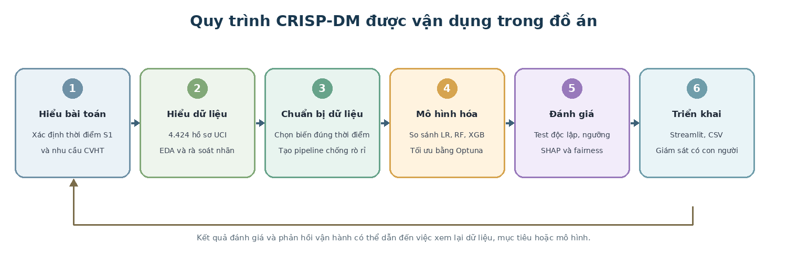{#fig-crispdm width=100%}

**Cách đọc @fig-crispdm.** Sáu ô được đánh số từ 1 đến 6, đọc từ trái sang phải; mỗi ô có tên giai đoạn và hai dòng mô tả hoạt động chính trong đồ án (ví dụ ô 2 ghi "4.424 hồ sơ UCI, EDA và rà soát nhãn", ô 4 ghi "So sánh LR, RF, XGB, tối ưu bằng Optuna"). Màu của ô chỉ để phân biệt giai đoạn, không mang ý nghĩa mức độ. Mũi tên nhỏ giữa các ô là luồng công việc chính. Đường gấp khúc ở dưới đi từ ô 6 (Triển khai) quay lại ô 1 (Hiểu bài toán), kèm chú thích rằng kết quả đánh giá và phản hồi vận hành có thể dẫn đến việc xem lại dữ liệu, mục tiêu hoặc mô hình.

**Vòng lặp trong đồ án.** Việc đối chiếu giữa thời điểm có thông tin (giai đoạn 2) và yêu cầu nghiệp vụ "cảnh báo đủ sớm" (giai đoạn 1) đã dẫn tới việc loại hai biến tài chính và chọn S1 ([Mục 3.2](#sec-scenarios)). Ở chiều ngược lại, một lần thí điểm thực tế sẽ tạo phản hồi mới về chất lượng dữ liệu, tải công việc của CVHT và mức phù hợp của ngưỡng.

## Nguyên tắc thiết kế thí nghiệm {#sec-exp-design}

### Phân loại nhị phân và mã hóa nhãn {#sec-binary-label}

Nhãn `Target` gốc có ba giá trị. Vì mục tiêu là cảnh báo nghỉ học, bài toán được rút về nhị phân: `Graduate` mã hóa 0, `Dropout` mã hóa 1 (lớp dương). `Enrolled` là trạng thái "đang học tại thời điểm thu thập"; vì kết cục cuối cùng chưa biết, đưa nhóm này vào huấn luyện với một nhãn gán tạm sẽ làm lệch mô hình, nên nhóm này chỉ được chấm điểm. Hệ quả là mọi số liệu hiệu năng trong báo cáo chỉ phản ánh nhóm đã có kết cục cuối ([Mục 6.3](#sec-limits) bàn lại giới hạn này). Tỷ lệ lớp dương trong tập có nhãn là 39,1%, tức mất cân bằng nhẹ; vì vậy đồ án dùng trọng số lớp (`class_weight`) cho một kiểm tra độ nhạy riêng thay vì sinh mẫu tổng hợp ([Mục 4.2](#sec-baselines)).

### Tập phát triển, tập kiểm thử và kiểm định chéo {#sec-split-cv}

Một mô hình đánh giá trên chính dữ liệu đã huấn luyện sẽ cho kết quả lạc quan. Vì vậy dữ liệu có nhãn được chia thành hai phần có vai trò khác nhau:

- **Tập phát triển (Dev, 80%)** dùng cho mọi quyết định thiết kế: so sánh kịch bản, so sánh mô hình, tinh chỉnh siêu tham số, chọn ngưỡng.
- **Tập kiểm thử (Test, 20%)** được giữ riêng và chỉ dùng để báo cáo kết quả sau khi mọi lựa chọn đã cố định.

Bên trong Dev, **stratified $k$-fold cross-validation** với $k=5$ chia Dev thành năm phần có tỷ lệ lớp gần bằng nhau; lần lượt mỗi phần làm tập xác nhận và bốn phần còn lại làm tập huấn luyện. Điểm CV là trung bình qua năm lần, và độ lệch chuẩn qua các fold cho biết mức dao động [@hastie2009]. Dự báo **out-of-fold (OOF)** là xác suất của mỗi mẫu Dev do mô hình chưa từng thấy mẫu đó tạo ra; ghép năm phần lại được một dự báo cho toàn bộ Dev mà không bị lạc quan, nên phù hợp để chọn ngưỡng. Chia theo hồ sơ ngẫu nhiên không mô phỏng việc dự báo cho một khóa tuyển sinh mới; đây là một giới hạn được nêu lại ở [Mục 6.3](#sec-limits).

### Rò rỉ dữ liệu {#sec-leakage-theory}

Rò rỉ (leakage) là việc thông tin không có tại thời điểm dự báo lọt vào quá trình học hoặc đánh giá, làm kết quả đẹp hơn thực tế. Đồ án kiểm soát ba dạng:

1. **Rò rỉ thời gian:** dùng biến ghi nhận sau mốc cảnh báo (ví dụ kết quả học kỳ 2 khi cảnh báo sau học kỳ 1) [@kabakchieva2013; @migueis2018].
2. **Rò rỉ nhãn:** để cột `Target` hoặc biến suy ra trực tiếp từ nó lọt vào đầu vào.
3. **Rò rỉ tiền xử lý:** fit bộ chuẩn hóa hoặc bộ điền thiếu trên toàn bộ dữ liệu, khiến thống kê của tập xác nhận/kiểm thử ảnh hưởng đến việc học tham số. Cách xử lý là đặt mọi bước fit vào pipeline và chỉ fit trên phần huấn luyện của từng fold.

## Các thuật toán và tối ưu siêu tham số {#sec-algorithms}

Ba họ mô hình được so sánh trên cùng đầu vào và cùng quy trình CV: một mô hình tuyến tính dễ kiểm tra và hai mô hình dựa trên cây có khả năng bắt tương tác phi tuyến.

**Logistic Regression (LR)** mô hình hóa xác suất lớp dương bằng hàm sigmoid của một tổ hợp tuyến tính các đặc trưng đã chuẩn hóa [@hosmer2013; @scikit]:
$$
\hat p = \sigma\!\left(\beta_0+\sum_{j}\beta_j x_j\right), \qquad \sigma(z)=\frac{1}{1+e^{-z}}.
$$
Tham số được học bằng cách cực tiểu hóa log-loss cộng một thành phần điều chuẩn phạt các hệ số lớn; mức điều chuẩn là một siêu tham số được Optuna tìm. Hệ số $\beta_j$ cho biết $x_j$ tăng một đơn vị (sau chuẩn hóa) làm log-odds $\ln\frac{\hat p}{1-\hat p}$ đổi bao nhiêu, nên mô hình dễ kiểm tra và kích thước rất nhỏ. Nhược điểm là không tự bắt được tương tác phi tuyến giữa các biến.

**Random Forest (RF)** huấn luyện nhiều cây quyết định, mỗi cây trên một mẫu bootstrap và mỗi lần tách chỉ xét một tập con ngẫu nhiên của đặc trưng, rồi lấy trung bình dự báo [@breiman2001]. Cách làm này giảm phương sai so với một cây đơn, nhưng cây sâu có thể khớp gần như hoàn hảo dữ liệu huấn luyện; điều đó được quan sát ở [Mục 4.4](#sec-selection).

**XGBoost (XGB)** xây dựng các cây tuần tự, mỗi cây sửa phần sai số còn lại của các cây trước theo hướng gradient, có điều chuẩn trên độ phức tạp của cây và cài đặt tối ưu về tính toán [@chen2016]. Mô hình thường mạnh trên dữ liệu bảng nhưng có nhiều siêu tham số (tốc độ học, độ sâu, số vòng, tỷ lệ lấy mẫu) và khó đọc trực tiếp hơn LR.

**Optuna** là khung tối ưu siêu tham số: người dùng viết một hàm mục tiêu nhận một "lượt thử" (trial), hàm này lấy mẫu siêu tham số từ miền tìm kiếm đã khai báo, huấn luyện và trả về điểm CV; Optuna dùng kết quả các lượt thử trước để chọn lượt thử sau [@akiba2019]. Trong đồ án mục tiêu là ROC-AUC CV và mỗi mô hình có 25 lượt thử.

## Tiền xử lý dữ liệu {#sec-preprocessing-theory}

Các bước tiền xử lý được gói trong một pipeline của scikit-learn để áp dụng nhất quán cho huấn luyện, kiểm thử và ứng dụng [@scikit].

- **`RobustScaler`** biến đổi $x' = (x-\text{median})/\text{IQR}$, với IQR là hiệu giữa phân vị 75 và 25. So với chuẩn hóa theo trung bình và độ lệch chuẩn, cách này ít bị kéo lệch bởi giá trị xa số đông như tuổi nhập học cao; nó không sửa dữ liệu sai.
- **Mã hóa one-hot** biến mỗi biến phân loại thành các cột 0/1 theo từng mức, với `handle_unknown="ignore"` để mức chưa từng gặp không làm pipeline dừng; mức hiếm được gộp theo cấu hình. Vì vậy trong biểu đồ SHAP xuất hiện các cột như `Course_171` hay `Application mode_39`: đó là cột one-hot của mã ngành 171 và mã phương thức nhập học 39.
- **`SimpleImputer`** điền giá trị thiếu (trung vị cho biến số, giá trị phổ biến nhất cho biến phân loại). Dữ liệu hiện tại không có giá trị thiếu, nên bước này là dự phòng cho dữ liệu áp dụng sau này.
- **Quy tắc IQR** đánh dấu ngoại lai khi $x<Q_1-1{,}5\,\text{IQR}$ hoặc $x>Q_3+1{,}5\,\text{IQR}$; đây là dấu hiệu để xem xét, không phải bằng chứng dữ liệu sai.

## Chỉ số đánh giá {#sec-metrics}

Với lớp dương là `Dropout`, mỗi dự báo nhị phân rơi vào một trong bốn ô của ma trận nhầm lẫn: TP (nghỉ học, được gắn cờ), FN (nghỉ học, bị bỏ sót), FP (không nghỉ học, bị gắn cờ nhầm) và TN (không nghỉ học, không gắn cờ). Các chỉ số phụ thuộc ngưỡng được định nghĩa như sau:

$$
\text{Precision}=\frac{TP}{TP+FP},\quad
\text{Recall}=\frac{TP}{TP+FN},\quad
\text{FPR}=\frac{FP}{FP+TN},\quad
\text{Accuracy}=\frac{TP+TN}{TP+TN+FP+FN}.
$$

Tỷ lệ gắn cờ là $(TP+FP)/n$, tức tỷ lệ hồ sơ CVHT phải xem xét. **ROC-AUC** không phụ thuộc ngưỡng: có thể hiểu là xác suất một hồ sơ nghỉ học được chọn ngẫu nhiên có điểm cao hơn một hồ sơ không nghỉ học được chọn ngẫu nhiên [@fawcett2006]; giá trị 0,5 là xếp hạng ngẫu nhiên. **Average Precision (AP)** tóm tắt đường Precision–Recall; mốc ngẫu nhiên của AP bằng tỷ lệ lớp dương (khoảng 0,392 trên Test), nên AP cho biết rõ hơn chất lượng trên lớp dương khi các lớp lệch nhau [@saito2015; @davis2006].

| Chỉ số | Phụ thuộc ngưỡng? | Trả lời câu hỏi | Giới hạn |
|---|---|---|---|
| ROC-AUC | Không | Mô hình có xếp hồ sơ nghỉ học lên trên không? | Không cho biết nên đặt ngưỡng ở đâu |
| Average Precision | Không | Xếp hạng tốt đến đâu trên lớp dương? | Phụ thuộc tỷ lệ lớp dương |
| Recall | Có | Bắt được bao nhiêu ca nghỉ học? | Tăng dễ dàng khi hạ ngưỡng |
| Precision | Có | Trong số bị gắn cờ, bao nhiêu thật sự nghỉ học? | Giảm khi hạ ngưỡng |
| Tỷ lệ gắn cờ | Có | CVHT phải xem bao nhiêu hồ sơ? | Không cho biết gắn cờ có đúng không |
| Accuracy | Có | Tỷ lệ dự báo đúng chung | Che giấu khác biệt giữa bỏ sót và báo nhầm |

: Các chỉ số đánh giá và ý nghĩa {#tbl-metrics}

## Giải thích mô hình bằng SHAP {#sec-shap-theory}

SHAP gán cho mỗi đặc trưng $j$ một giá trị đóng góp $\phi_j$ dựa trên giá trị Shapley của lý thuyết trò chơi hợp tác: trung bình đóng góp biên của đặc trưng đó qua mọi thứ tự thêm đặc trưng vào mô hình [@lundberg2017],
$$
\phi_j=\sum_{S\subseteq F\setminus\{j\}}\frac{|S|!\,(|F|-|S|-1)!}{|F|!}\Big[f(S\cup\{j\})-f(S)\Big],
$$
với $F$ là tập đặc trưng. Tính cộng tính cho phép viết đầu ra của một hồ sơ là $f(\mathbf{x})=\phi_0+\sum_j\phi_j$, trong đó $\phi_0$ là giá trị nền (kỳ vọng trên dữ liệu nền). Với mô hình tuyến tính và giả định các đặc trưng độc lập, $\phi_j=\beta_j\,(x_j-\mathbb{E}[x_j])$, tức đóng góp bằng hệ số nhân với độ lệch của đặc trưng so với giá trị trung bình; đây là lý do SHAP phù hợp và rẻ khi tính cho LR. Biên độ từ khoảng $-15$ đến $+5$ trên trục SHAP ở @fig-shap cho thấy đầu ra được biểu diễn theo thang log-odds chứ không phải xác suất.

Có ba điều cần nhớ khi đọc SHAP. Thứ nhất, giá trị SHAP mô tả cách *mô hình* dùng biến so với nền tham chiếu; chúng không xác lập nguyên nhân xã hội hay tác động của một can thiệp. Thứ hai, khi các biến tương quan mạnh (ví dụ số môn đăng ký và số môn đạt), phần đóng góp bị chia giữa chúng và dấu của từng biến phải được đọc cùng nhau. Thứ ba, SHAP đo đóng góp trên các cột sau tiền xử lý (kể cả cột one-hot), nên một ngành có thể xuất hiện như một đặc trưng riêng.

## Công bằng thuật toán {#sec-fairness-theory}

Công bằng được kiểm tra bằng cách tính cùng một bộ chỉ số trên từng nhóm (giới tính, nhóm tuổi, học bổng) tại ngưỡng vận hành. Hai khái niệm thường gặp là **demographic parity** (tỷ lệ bị gắn cờ bằng nhau giữa các nhóm) và **equalized odds** (Recall và FPR bằng nhau giữa các nhóm). Khi tỷ lệ nghỉ học nền khác nhau giữa các nhóm, một mô hình không hoàn hảo nói chung không thể thỏa mãn đồng thời cả hai, nên lựa chọn chỉ tiêu phụ thuộc vào hậu quả của từng loại sai sót [@mehrabi2021; @barocas2023]. Trong bối cảnh cảnh báo hỗ trợ, FPR cao ở một nhóm nghĩa là nhóm đó bị gọi nhầm nhiều hơn, còn Recall thấp nghĩa là nhóm đó bị bỏ sót nhiều hơn; cả hai đều cần được theo dõi ([Mục 5.4](#sec-fairness-eval)).

## Kiến trúc giải pháp {#sec-arch}

@fig-architecture đặt luồng dữ liệu và luồng sử dụng vào cùng một sơ đồ. Notebook chuẩn bị dữ liệu, tạo đặc trưng, huấn luyện và đánh giá; mô hình Logistic Regression đã chọn cùng cấu hình được lưu trong `models/artifacts/`. Ứng dụng Streamlit đọc các tạo tác này, nhận dữ liệu đầu vào, tính điểm, phân tầng và cung cấp phần giải thích SHAP. CVHT là người kiểm tra đầu ra và quyết định bước hỗ trợ.

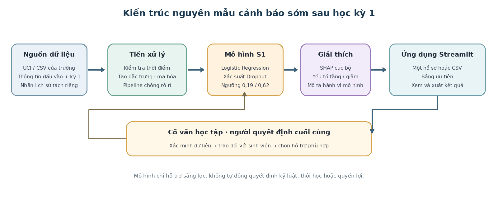{#fig-architecture width=95%}

**Cách đọc @fig-architecture.** Hàng trên có năm khối nối nhau bằng mũi tên: (1) *Nguồn dữ liệu* gồm UCI hoặc CSV của trường, thông tin đầu vào và kỳ 1, nhãn lịch sử tách riêng; (2) *Tiền xử lý* kiểm tra thời điểm, tạo đặc trưng, mã hóa trong pipeline chống rò rỉ; (3) *Mô hình S1* là Logistic Regression xuất xác suất `Dropout` với hai ngưỡng 0,19 và 0,62; (4) *Giải thích* là SHAP cục bộ, nêu yếu tố làm tăng hoặc giảm điểm; (5) *Ứng dụng Streamlit* nhận một hồ sơ hoặc CSV, hiển thị bảng ưu tiên và xuất kết quả. Hàng dưới là khối *Cố vấn học tập, người quyết định cuối cùng*: xác minh dữ liệu, trao đổi với sinh viên, chọn hỗ trợ phù hợp. Đường từ ứng dụng đi xuống khối CVHT rồi quay lên khối mô hình biểu diễn vòng phản hồi dự kiến: kết quả xác minh và hỗ trợ là căn cứ để hiệu chỉnh mô hình và ngưỡng ở các vòng sau.

Sơ đồ cũng làm rõ ranh giới vận hành: mô hình không kết nối trực tiếp với quyết định học vụ (dòng chú thích cuối hình nêu rõ mô hình chỉ hỗ trợ sàng lọc, không tự động quyết định kỷ luật, thôi học hoặc quyền lợi). Dữ liệu `Enrolled` chỉ được chấm điểm; vì chưa có nhãn cuối nên không thể dùng để tính hiệu năng. Kết quả xuất cần được bảo vệ như dữ liệu học tập nhạy cảm.

# Dữ liệu và tiền xử lý {#sec-ch3}

## Nguồn và cấu trúc dữ liệu {#sec-data-source}

Nguồn là bộ *Predict Students' Dropout and Academic Success* trên UCI Machine Learning Repository. Bộ dữ liệu có 4.424 dòng, 36 thuộc tính đầu vào và nhãn `Target` với ba giá trị `Graduate`, `Dropout`, `Enrolled`; UCI ghi nhận giấy phép CC BY 4.0 [@realinho2021]. Theo mô tả của các tác giả, dữ liệu được tổng hợp từ nhiều cơ sở dữ liệu của một cơ sở đào tạo bậc đại học tại Bồ Đào Nha, gồm sinh viên của nhiều ngành khác nhau như nông học, thiết kế, giáo dục, điều dưỡng, báo chí, quản lý, công tác xã hội và công nghệ [@realinho2022]; điều này khớp với các tên ngành xuất hiện trong @fig-group. Trong đồ án, `Graduate` được mã hóa 0, `Dropout` mã hóa 1; `Enrolled` chưa có nhãn cuối nên không tham gia huấn luyện hay đánh giá.

Về cấu trúc, 36 thuộc tính đầu vào chia thành bốn khối: 21 thuộc tính hồ sơ và đầu vào (nhân khẩu học, tuyển sinh, nghề nghiệp và trình độ của cha mẹ, nợ, học phí, học bổng), 6 thuộc tính kết quả học kỳ 1, 6 thuộc tính kết quả học kỳ 2 và 3 chỉ số kinh tế vĩ mô. Nhiều thuộc tính phân loại được lưu dưới dạng *mã số* (ví dụ `Course`, `Application mode`), nên cần ánh xạ theo từ điển của UCI khi diễn giải. Mỗi học kỳ có cùng một bộ sáu số liệu: số môn được công nhận tín chỉ (*credited*), số môn đăng ký (*enrolled*), số lượt đánh giá (*evaluations*), số môn đạt (*approved*), điểm trung bình (*grade*) và số môn không có đánh giá (*without evaluations*).

| Tập/nhãn | Số hồ sơ | Tỷ lệ trong tập có nhãn | Sử dụng |
|---|---:|---:|---|
| Graduate | 2.209 | 60,9% | Huấn luyện/đánh giá |
| Dropout | 1.421 | 39,1% | Huấn luyện/đánh giá |
| Enrolled | 794 | — | Chấm điểm riêng; nhãn tương lai chưa biết |
| Tổng | 4.424 | — | — |

: Phân bố nhãn và cách sử dụng các tập hồ sơ {#tbl-labels}

Tập có nhãn được chia ngẫu nhiên theo hồ sơ bằng stratified split: 2.904 hồ sơ phát triển (Dev, 80%) và 726 hồ sơ kiểm thử (Test, 20%), seed 42. Stratification giữ tỷ lệ hai lớp gần tương tự ở hai phần. Trong Dev, stratified 5-fold cross-validation lần lượt dùng bốn fold để huấn luyện và fold còn lại để xác nhận; mỗi fold được dùng làm validation một lần.

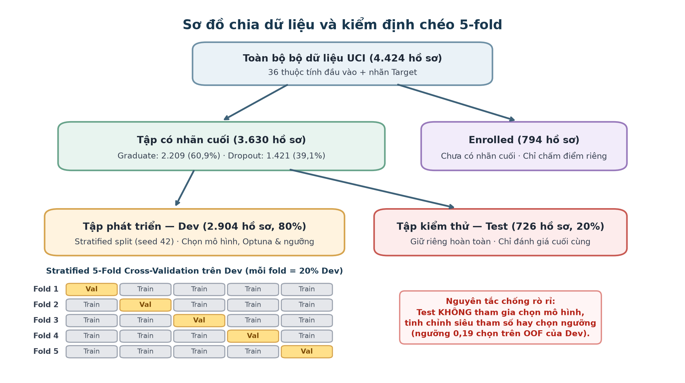{#fig-split width=85%}

**Cách đọc @fig-split.** Khối trên cùng là toàn bộ 4.424 hồ sơ. Mũi tên thứ nhất tách nhóm có nhãn cuối (3.630 hồ sơ: 2.209 Graduate và 1.421 Dropout) khỏi nhóm `Enrolled` (794 hồ sơ), nhóm này chỉ được chấm điểm. Mũi tên thứ hai chia nhóm có nhãn thành Dev (2.904, 80%) và Test (726, 20%) theo stratified split với seed 42. Lưới năm hàng phía dưới minh họa 5-fold CV trên Dev: mỗi hàng là một vòng lặp, ô vàng là fold dùng để xác nhận, bốn ô xám là các fold dùng để huấn luyện; qua năm hàng, mỗi fold làm validation đúng một lần. Dòng chữ đỏ bên phải nhấn mạnh Test không tham gia chọn mô hình, tinh chỉnh hay chọn ngưỡng. Đây là chia ngẫu nhiên trong cùng bộ dữ liệu, không phải kiểm định trên khóa tuyển sinh hoặc năm học mới; vì vậy kết quả vẫn cần được xác nhận bằng kiểm định ngoài thời gian và ngoài cơ sở.

## Thời điểm dự báo và các kịch bản thông tin (S0, S1, S1F, S2) {#sec-scenarios}

Đây là quyết định thiết kế quan trọng nhất của đồ án, vì nó quyết định biến nào được phép vào mô hình. Hai chữ **S1** xuất hiện xuyên suốt báo cáo và ứng dụng; mục này định nghĩa chúng và giải thích chúng đến từ đâu.

**Vấn đề.** Một hệ thống cảnh báo chỉ được dùng thông tin đã có tại thời điểm phát cảnh báo. Bộ dữ liệu UCI lại gộp thông tin của nhiều thời điểm vào một bảng: có cột ghi nhận lúc nhập học, có cột ghi nhận cuối học kỳ 1, có cột ghi nhận cuối học kỳ 2, và một số cột tài chính không rõ ghi nhận lúc nào. Nếu đưa tất cả vào mô hình, AUC sẽ cao nhưng mô hình dựa vào những thông tin mà cố vấn chưa thể biết khi cần ra quyết định, hoặc vào những dấu hiệu xuất hiện sau khi sinh viên đã bắt đầu rời học.

**Định nghĩa.** Một *kịch bản thông tin* là một tập cột đầu vào được phép dùng tại một mốc thời gian, cùng các đặc trưng dẫn xuất chỉ tính từ những cột đó. Ký hiệu đặt như sau: chữ S viết tắt cho *scenario* (kịch bản); chỉ số 0, 1, 2 là số học kỳ đã hoàn tất tại thời điểm dự báo; hậu tố F (*financial*) nghĩa là có thêm biến tài chính về nợ và học phí. Do đó:

- **S0**: dự báo ngay lúc nhập học, chưa có bất kỳ kết quả học tập nào.
- **S1**: dự báo sau khi học kỳ 1 kết thúc và điểm đã khóa, chưa dùng hai biến nợ và học phí.
- **S1F**: như S1, thêm các biến tài chính (`Debtor`, `Tuition fees up to date`) và hai đặc trưng dẫn xuất tài chính.
- **S2**: dự báo sau khi học kỳ 2 kết thúc, có cả tài chính.

| Kịch bản | Mốc thời gian | Thêm so với kịch bản liền trước | Tổng số biến |
|---|---|---|---:|
| S0 | Lúc nhập học | 19 thuộc tính hồ sơ/đầu vào (không gồm `Debtor`, `Tuition fees up to date`), 3 chỉ số vĩ mô, `grade_gap` | 23 |
| S1 | Hết học kỳ 1 | 6 biến gốc kỳ 1 và 4 biến tỷ lệ kỳ 1 (`s1_approval_rate`, `s1_eval_pass_rate`, `s1_no_eval_rate`, `s1_ghost`) | 33 |
| S1F | Hết học kỳ 1, có tài chính | `Debtor`, `Tuition fees up to date`, `fin_risk`, `fin_no_aid` | 37 |
| S2 | Hết học kỳ 2, có tài chính | 6 biến gốc kỳ 2, các biến dẫn xuất `s2_*` và chênh lệch giữa kỳ `d_*` | 50 |

: Thành phần của bốn kịch bản thông tin theo thời điểm {#tbl-scenario-def}

Các số trong cột cuối khớp với cách đếm trên 36 thuộc tính gốc: 21 thuộc tính hồ sơ trừ 2 biến nợ/học phí còn 19; cộng 3 chỉ số vĩ mô và `grade_gap` được 23 (S0); cộng 6 biến gốc kỳ 1 và 4 biến tỷ lệ kỳ 1 được 33 (S1); cộng 4 biến tài chính được 37 (S1F); S2 là 50 biến sau khi thêm các biến kỳ 2 và biến dẫn xuất tương ứng. Danh sách cột chính xác của S1 được lưu trong `models/artifacts/meta.json` ([Phụ lục A](#sec-app-a)).

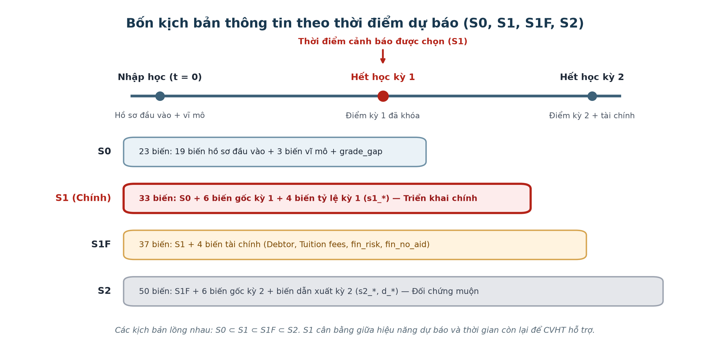{#fig-timeline width=85%}

**Cách đọc @fig-timeline.** Trục thời gian ở trên có ba mốc: nhập học ($t=0$), hết học kỳ 1 và hết học kỳ 2. Mũi tên đỏ chỉ vào mốc hết học kỳ 1, đánh dấu thời điểm cảnh báo được chọn. Bốn thanh ngang bên dưới tương ứng S0, S1, S1F, S2; mỗi thanh ghi số biến và thành phần. Thanh S1 được tô đỏ để nhấn mạnh đây là kịch bản triển khai chính, ba thanh còn lại màu xám/xanh nhạt là kịch bản so sánh. Các kịch bản lồng nhau: S1 chứa S0, S1F chứa S1, S2 chứa S1F.

**Vì sao chọn S1.** Có bốn lý do, đều dựa trên dữ liệu và yêu cầu nghiệp vụ:

1. **Còn thời gian hỗ trợ.** Sau khi điểm học kỳ 1 khóa, vẫn còn học kỳ 2 để CVHT liên hệ và để sinh viên thay đổi cách học. Cảnh báo sau học kỳ 2 (S2) đến khi nhiều hồ sơ đã quyết định rời trường.
2. **Mọi biến đều biết tại mốc dự báo.** Kết quả học kỳ 1 chỉ xuất hiện khi học kỳ 1 kết thúc, không thể dùng sớm hơn; S1 vì thế là mốc sớm nhất có kết quả học tập.
3. **Loại các biến chưa rõ thời điểm.** Bộ dữ liệu không nói `Debtor` và `Tuition fees up to date` được ghi nhận lúc nào. Hai biến này có tương quan mô tả rất mạnh với nhãn ([Mục 3.4](#sec-eda)), nên có thể phản ánh tình trạng đã diễn ra cùng với việc nghỉ học thay vì dấu hiệu báo trước. Chấp nhận mức AUC thấp hơn của S1 so với S1F đổi lấy một cảnh báo có thể bảo vệ được về mặt thời gian.
4. **Lợi ích biên giảm dần.** Bước nhảy từ S0 lên S1 lớn, trong khi S1F và S2 chỉ tăng thêm rất ít ([Mục 4.1](#sec-scenario-eval), @tbl-delta-auc).

Trong S1 vẫn có `Scholarship holder`, thuộc nhóm tài chính nhưng nằm trong khối 19 thuộc tính hồ sơ/đầu vào theo cấu hình notebook. Báo cáo giữ biến này vì lý do đó; tại cơ sở thực tế cần xác minh thời điểm ghi nhận học bổng trước khi dùng ([Mục 6.3](#sec-limits)).

**Vai trò của ba kịch bản còn lại.** S0 cho biết một cảnh báo ngay lúc nhập học (chưa có điểm) khả thi đến đâu. S1F là phép kiểm tra độ nhạy: nếu thông tin tài chính được xác nhận có sẵn đầu kỳ 2 thì có thể bổ sung bao nhiêu hiệu năng. S2 là mốc đối chứng muộn, dùng để thấy mức tăng AUC khi chấp nhận thông tin đến muộn. Cả ba chỉ phục vụ so sánh và không được trộn vào đầu vào của mô hình S1.

## Nhóm biến {#sec-var-groups}

| Nhóm | Ví dụ biến | Thời điểm/ghi chú | Có trong |
|---|---|---|---|
| Hồ sơ đầu vào | Ngành, phương thức nhập học, tuổi, giới tính, điểm đầu vào, trình độ trước | Có trước hoặc lúc nhập học | S0, S1, S1F, S2 |
| Kết quả kỳ 1 | Số môn đăng ký, số lượt đánh giá, số môn đạt, điểm kỳ 1, môn không có đánh giá | Có vào cuối học kỳ 1; dùng trong S1 | S1, S1F, S2 |
| Tài chính | Nợ, học phí đúng hạn, học bổng | Thời điểm đo của hai biến nợ/học phí không rõ; loại khỏi S1 (học bổng nằm trong khối hồ sơ) | S1F, S2 |
| Vĩ mô | Thất nghiệp, lạm phát, GDP | Ít giá trị khác nhau; có thể đại diện cho khóa/năm | S0, S1, S1F, S2 |
| Kết quả kỳ 2 | Tín chỉ, môn đăng ký/đạt, điểm kỳ 2 | Chỉ dùng trong kịch bản đối chứng muộn S2 | S2 |

: Nhóm biến theo thời điểm có sẵn {#tbl-variable-groups}

Có 33 đặc trưng đầu vào cho S1 theo pipeline: thông tin đầu vào, sáu biến gốc kỳ 1 và bốn biến tạo từ kỳ 1, cùng các biến khác có sẵn trước dự báo. Ba biến vĩ mô được giữ theo cấu hình notebook nhưng số mức quan sát hạn chế, nên không diễn giải như tín hiệu thời gian thực độc lập.

## Khám phá dữ liệu {#sec-eda}

Phần khám phá dữ liệu (EDA) trả lời ba câu hỏi: dữ liệu có những đặc điểm gì cần xử lý, biến nào có liên hệ với nhãn, và liên hệ đó đặt ra yêu cầu thiết kế gì. EDA được thực hiện bằng pandas, Matplotlib và seaborn [@pandas; @hunter2007; @waskom2021]. Mọi so sánh dưới đây là liên hệ thô trên dữ liệu có nhãn; chúng không kiểm soát yếu tố gây nhiễu và không chứng minh nguyên nhân.

### Phân phối nhãn và tuổi nhập học {#sec-eda-age}

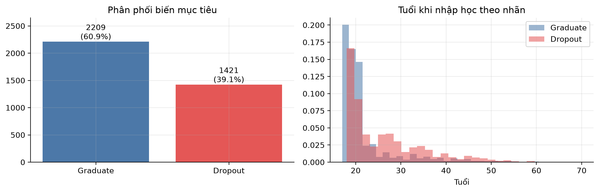{#fig-target-age width=80%}

**Cách đọc.** @fig-target-age gồm hai biểu đồ. Biểu đồ cột bên trái có trục ngang là hai nhãn (Graduate màu xanh, Dropout màu đỏ), trục dọc là số hồ sơ; nhãn trên đầu cột ghi số hồ sơ và tỷ lệ. Biểu đồ bên phải là histogram của tuổi khi nhập học (trục ngang, từ khoảng 17 đến hơn 70 tuổi), được chuẩn hóa theo tỷ lệ trong *từng lớp* (trục dọc), nên hai nhóm có thể so sánh dù khác cỡ mẫu; hai histogram chồng lên nhau với màu như bên trái.

**Quan sát.** Trong 3.630 hồ sơ đã có kết quả, 2.209 người (60,9%) tốt nghiệp và 1.421 người (39,1%) nghỉ học; đây là tỷ lệ lớp trong dữ liệu phân tích, không phải tỷ lệ nghỉ học của toàn bộ sinh viên đại học. Ở histogram, cả hai nhóm tập trung nhiều ở tuổi nhập học khoảng 18–20 (cột cao nhất của Graduate ở mức xấp xỉ 0,2), nhưng phân phối `Dropout` có đuôi dài hơn về các tuổi cao và một số khoảng tuổi từ giữa 20 trở lên có tỷ trọng lớn hơn so với nhóm tốt nghiệp.

**Hàm ý và thận trọng.** Hình gợi ý tuổi có liên hệ với kết quả cuối trong tập này; nó không chứng minh tuổi gây ra nghỉ học, cũng không cho phép gán hoàn cảnh gia đình hay việc làm cho từng sinh viên. Hàm ý phù hợp là hỏi về nhu cầu lịch học và hỗ trợ linh hoạt khi tư vấn, không dùng tuổi làm căn cứ hạn chế cơ hội. Vì tuổi là thuộc tính nhạy cảm, nó cũng được đưa vào phân tích công bằng ở [Mục 5.4](#sec-fairness-eval).

### Tỷ lệ nghỉ học theo nhóm phân loại {#sec-eda-group}

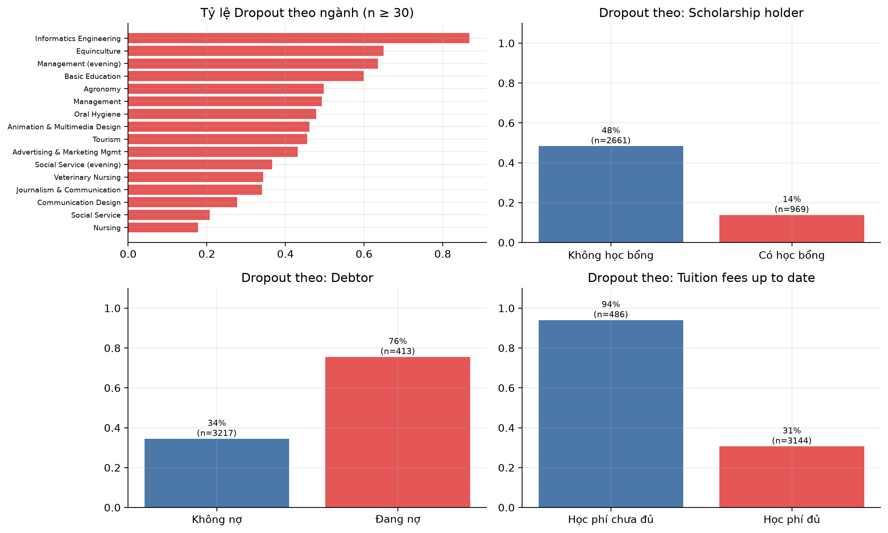{#fig-group width=80%}

**Cách đọc.** @fig-group có bốn ô, mỗi ô đo cùng một đại lượng: tỷ lệ `Dropout` trong nhóm (trục thể hiện từ 0 đến 1), kèm cỡ mẫu $n$. Ô trên trái là thanh ngang theo ngành, chỉ hiển thị ngành có ít nhất 30 hồ sơ để tránh xếp hạng những ngành chỉ có vài hồ sơ. Ba ô còn lại là biểu đồ cột hai nhóm theo học bổng, nợ và học phí. Màu xanh/đỏ chỉ phân biệt hai cột, không biểu thị tốt hay xấu.

**Quan sát theo ngành.** Tỷ lệ thô dao động rõ rệt: Informatics Engineering cao nhất, gần 0,87; theo sau là Equinculture (khoảng 0,65) và Management (evening) (khoảng 0,64); ở đầu thấp là Nursing (khoảng 0,18), Social Service (khoảng 0,21) và Communication Design (khoảng 0,28). Ngưỡng $n\ge30$ không loại bỏ nhiễu ở các ngành có cỡ mẫu vừa phải.

**Quan sát theo ba biến tài chính.** Tỷ lệ `Dropout` là khoảng 48% ở nhóm không có học bổng ($n=2.661$) và 14% ở nhóm có học bổng ($n=969$). Nhóm đang nợ có khoảng 76% ($n=413$) so với 34% ở nhóm không nợ ($n=3.217$). Nhóm học phí chưa đủ có khoảng 94% ($n=486$) so với 31% ở nhóm đã đóng đủ ($n=3.144$).

**Hàm ý và thận trọng.** Chênh lệch ở nợ và học phí rất lớn, nhưng thời điểm đo của hai biến này không rõ nên chúng không được đưa vào S1 ([Mục 3.2](#sec-scenarios)). Các so sánh trên là liên hệ thô, có thể chịu ảnh hưởng của ngành, thời điểm và cơ cấu hồ sơ; không thể diễn giải rằng học bổng tự nó làm giảm nghỉ học. Hình này giúp xác định lát cắt cần kiểm toán công bằng và đặt câu hỏi hỗ trợ, chứ không phải cơ sở để tự động phân bổ hay từ chối quyền lợi.

### Quan hệ đa biến của kết quả học kỳ 1 {#sec-eda-multi}

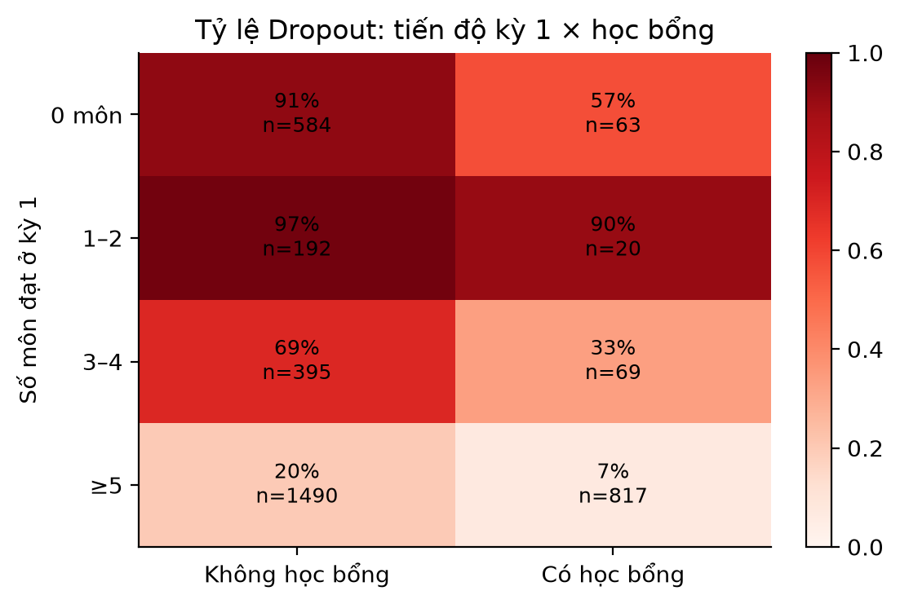{#fig-multi width=70%}

**Cách đọc.** @fig-multi là heatmap hai chiều. Mỗi hàng là một nhóm số môn đạt ở kỳ 1 (0 môn, 1–2 môn, 3–4 môn, từ 5 môn trở lên); mỗi cột là tình trạng học bổng (không có / có). Màu của ô thể hiện tỷ lệ `Dropout` theo thang bên phải (trắng hồng là gần 0, đỏ sẫm là gần 1); mỗi ô ghi cả tỷ lệ lẫn số hồ sơ $n$ để người đọc biết ô nào có mẫu nhỏ.

| Số môn đạt kỳ 1 | Không học bổng | Có học bổng |
|---|---|---|
| 0 môn | 91% (n=584) | 57% (n=63) |
| 1–2 môn | 97% (n=192) | 90% (n=20) |
| 3–4 môn | 69% (n=395) | 33% (n=69) |
| $\ge 5$ môn | 20% (n=1.490) | 7% (n=817) |

: Tỷ lệ `Dropout` theo số môn đạt kỳ 1 và tình trạng học bổng (số liệu của @fig-multi) {#tbl-heatmap}

**Quan sát.** Có hai xu hướng rõ. Thứ nhất, tỷ lệ giảm mạnh khi số môn đạt tăng: từ trên 90% ở nhóm đạt 1–2 môn xuống 20% ở nhóm đạt từ 5 môn (không học bổng), và từ 90% xuống 7% ở nhóm có học bổng. Thứ hai, ở mọi mức tiến độ, nhóm có học bổng có tỷ lệ thấp hơn nhóm không có. Tổng các ô khớp với cỡ mẫu của @fig-group (584+192+395+1.490 = 2.661 và 63+20+69+817 = 969).

**Điểm chưa đơn điệu cần ghi nhận.** Tỷ lệ ở nhóm đạt 0 môn (91% và 57%) *thấp hơn* nhóm đạt 1–2 môn (97% và 90%), tức không đơn điệu giảm theo số môn đạt. Dữ liệu hiện có chưa đủ để giải thích; một giả thuyết cần kiểm tra là nhóm 0 môn có lẫn hồ sơ không đăng ký hoặc không có lượt đánh giá nào, và thuộc tính này được mô hình nắm bắt qua các biến như `s1_ghost` ([Mục 3.5](#sec-clean-feat)). Nhóm có học bổng đạt 1–2 môn chỉ có 20 hồ sơ nên độ bất định rất cao.

**Hàm ý.** Đây là tương quan phân nhóm, không kiểm soát các yếu tố khác và không chứng minh học bổng hay số môn đạt là nguyên nhân. Trong quy trình tư vấn, số môn chưa đạt hoặc vắng đánh giá có thể giúp CVHT bắt đầu xác minh khó khăn cụ thể.

### Tương quan giữa các biến định lượng {#sec-eda-corr}

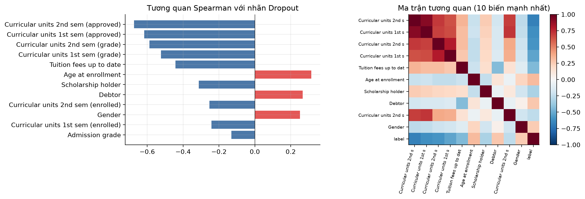{#fig-corr width=85%}

**Cách đọc.** @fig-corr dùng hệ số tương quan hạng Spearman $\rho$, phù hợp khi quan hệ đơn điệu nhưng không nhất thiết tuyến tính và khi có biến nhị phân. Biểu đồ trái là các thanh ngang xếp theo $|\rho|$ giữa từng biến và nhãn (với `Dropout`=1): thanh xanh nằm bên trái là tương quan âm, thanh đỏ bên phải là tương quan dương. Biểu đồ phải là ma trận tương quan giữa 10 biến nổi bật và nhãn, thang màu từ $-1$ (xanh đậm) đến $+1$ (đỏ đậm), đường chéo luôn bằng 1.

**Quan sát biểu đồ trái.** Các tương quan âm mạnh nhất thuộc về kết quả học tập: số môn đạt kỳ 1 (xấp xỉ $-0{,}62$), số môn đạt kỳ 2 (xấp xỉ $-0{,}67$) và điểm trung bình hai kỳ, nghĩa là giá trị học tập cao hơn thường đi cùng nhãn nghỉ học thấp hơn. `Tuition fees up to date` cũng âm khá mạnh. Các tương quan dương đáng chú ý là tuổi nhập học (khoảng 0,31), nợ (khoảng 0,27) và giới tính (khoảng 0,25; tương ứng với mã nam, khớp với tỷ lệ `Dropout` của nam cao hơn ở @tbl-fairness); đây là liên hệ theo cách mã hóa tương ứng, không phải tác động nhân quả.

**Quan sát ma trận bên phải.** Bốn biến học tập (số môn đạt và điểm của hai kỳ) tạo thành một khối đỏ đậm: số môn đạt kỳ 1 và kỳ 2 có $\rho$ khoảng 0,91, và số môn đạt cũng tương quan mạnh với điểm số cùng kỳ. Hàng và cột của nhãn có màu xanh ở các biến học tập và đỏ ở tuổi, nợ, giới tính, đúng như biểu đồ trái.

**Hàm ý.** Các cặp tương quan cao chứa thông tin chồng lấp; điều chuẩn trong LR và pipeline giúp kiểm soát việc học, nhưng không biến các hệ số thành bằng chứng độc lập, và khi đọc SHAP phải đọc các biến này cùng nhau ([Mục 5.3](#sec-shap-eval)). Các biến kỳ 2 trong hình chỉ dùng cho khám phá và đối chứng muộn, tuyệt đối không đưa vào S1. Ba biến kinh tế vĩ mô chỉ có 9–10 giá trị rời rạc, nên không thể xem như đo lường riêng biệt ở cấp sinh viên.

### Tổng hợp phát hiện EDA {#sec-eda-summary}

| Phát hiện | Bằng chứng | Quyết định thiết kế |
|---|---|---|
| Kết quả học kỳ 1 mang nhiều tín hiệu nhất | $\rho\approx-0{,}62$ với số môn đạt; @tbl-heatmap | Chọn mốc cảnh báo sau kỳ 1 (S1) |
| Nợ và học phí liên hệ rất mạnh nhưng thời điểm đo không rõ | 76% so với 34%; 94% so với 31% | Loại khỏi S1, giữ ở S1F để so sánh |
| Biến kỳ 2 tương quan mạnh nhưng đến muộn | $\rho\approx-0{,}67$ | Chỉ dùng ở S2, không dùng cho S1 |
| Có chênh lệch theo ngành, tuổi, giới tính, học bổng | @fig-group, @fig-target-age | Kiểm toán công bằng theo lát cắt ([Mục 5.4](#sec-fairness-eval)) |
| Các biến học tập tương quan chồng lấp | $\rho\approx0{,}91$ giữa số môn đạt hai kỳ | Dùng điều chuẩn; đọc SHAP theo nhóm biến |
| Biến vĩ mô có ít mức giá trị | 9–10 giá trị rời rạc | Giữ theo cấu hình nhưng không diễn giải như tín hiệu cá nhân |

: Tổng hợp phát hiện EDA và quyết định thiết kế tương ứng {#tbl-eda-summary}

## Làm sạch và tạo đặc trưng {#sec-clean-feat}

### Kiểm soát rò rỉ thời gian và nhãn {#sec-leakage-ctrl}

Thời điểm kịch bản dự báo quyết định biến nào được phép đưa vào mô hình. Những biến ghi nhận sau khi sinh viên đã hoàn tất hoặc rời chương trình có thể làm AUC cao hơn nhưng không khả dụng tại thời điểm cảnh báo. Thiết kế S1 vì vậy giữ các trường đầu vào và kết quả học kỳ 1; kết quả kỳ 2 chỉ xuất hiện trong kịch bản đối chứng S2. Hai trường nợ và học phí bị loại khỏi S1 do thời điểm đo chưa rõ.

| Nhóm thông tin | Ví dụ | Xử lý trong S1 | Rủi ro nếu dùng sai thời điểm |
|---|---|---|---|
| Đầu vào tuyển sinh | Tuổi, ngành, điểm đầu vào, phương thức nhập học | Giữ | Thấp nếu dữ liệu có trước khi dự báo |
| Kết quả kỳ 1 | Số môn đăng ký, đánh giá, đạt, điểm trung bình | Giữ sau khi có điểm kỳ 1 | Không thể dùng trước khi kết thúc kỳ 1 |
| Tài chính | Nợ, học phí đúng hạn | Loại khỏi cấu hình S1 | Có thể là tín hiệu hậu nghiệm hoặc thiếu nhất quán thời điểm |
| Kết quả kỳ 2 | Số môn đạt và điểm kỳ 2 | Chỉ dùng đối chứng S2 | Rò rỉ trực tiếp vào cảnh báo đầu kỳ 2 |
| Nhãn `Target` | `Graduate`, `Dropout`, `Enrolled` | Không dùng làm biến đầu vào | Rò rỉ nhãn nếu vô tình giữ trong CSV tải lên |

: Kiểm soát rò rỉ thời gian và nhãn trong S1 {#tbl-leakage}

Với cột `Target` có thể lọt vào tệp CSV do người dùng tải lên, ứng dụng chủ động loại cột này khỏi đầu vào trước khi chấm điểm ([Mục 6.1](#sec-app)).

### Chất lượng dữ liệu và ngoại lai {#sec-data-quality}

Notebook kiểm tra dòng trùng hoàn toàn sau khi bỏ nhãn/kết quả và ghi nhận 0 dòng trùng; dữ liệu nguồn cũng không có giá trị thiếu trong lần chạy hiện tại, nên `SimpleImputer` chỉ là bước dự phòng cho dữ liệu áp dụng sau này. Quy tắc IQR ([Mục 2.4](#sec-preprocessing-theory)) đánh dấu một số giá trị xa phần lớn quan sát, nhưng ngoại lai không đồng nghĩa với dữ liệu sai: tuổi nhập học cao hay số tín chỉ được công nhận lớn là các trường hợp hợp lý về nghiệp vụ. Vì vậy các giá trị này được xem xét và giữ lại, không bị xóa tự động; `RobustScaler` giúp giảm độ nhạy của mô hình với chúng. Biến phân loại được one-hot encode ([Mục 2.4](#sec-preprocessing-theory)) [@scikit].

### Tạo đặc trưng {#sec-feat-eng}

Các đặc trưng tạo mới nhằm cung cấp cách biểu diễn có ý nghĩa nghiệp vụ hơn các số đếm tuyệt đối: ví dụ "đạt 3 môn" mang ý nghĩa rất khác nhau với sinh viên đăng ký 3 môn và đăng ký 8 môn. Không có gì bảo đảm mọi biến mới đều hữu ích; đóng góp của chúng được kiểm chứng gián tiếp qua baseline và SHAP.

| Đặc trưng tạo mới | Định nghĩa | Ý nghĩa nghiệp vụ |
|---|---|---|
| `s1_approval_rate` | Môn đạt / môn đăng ký kỳ 1 | Tỷ lệ hoàn thành khối lượng đã đăng ký |
| `s1_eval_pass_rate` | Môn đạt / lượt đánh giá kỳ 1 | Tỷ lệ vượt qua trong số lần được đánh giá |
| `s1_no_eval_rate` | Môn không có đánh giá / môn đăng ký kỳ 1 | Mức độ đăng ký nhưng không được đánh giá |
| `s1_ghost` | Cờ: có môn đăng ký nhưng không có lượt đánh giá | Dấu hiệu "đăng ký nhưng không tham gia" |
| `grade_gap` | Điểm đầu vào trừ điểm bằng cấp trước | Chênh lệch giữa hai thang thành tích đầu vào |

: Định nghĩa các đặc trưng tạo mới {#tbl-features}

*Ví dụ minh họa (giả định, không phải hồ sơ thật):* một sinh viên đăng ký 6 môn, có 8 lượt đánh giá, đạt 3 môn và có 1 môn không có đánh giá sẽ có `s1_approval_rate` $=3/6=0{,}50$, `s1_eval_pass_rate` $=3/8=0{,}375$, `s1_no_eval_rate` $=1/6\approx0{,}167$ và `s1_ghost` $=0$.

Các phép chia có mẫu số 0 được quy về 0 trong hàm tiện ích. Các biến này chỉ dùng dữ liệu trong cùng hồ sơ, nên không trộn thông tin giữa train/test, nhưng chúng có quan hệ toán học với biến gốc và không được xem là bằng chứng độc lập. Sức mạnh của nhóm biến tỷ lệ thể hiện ở baseline: một luật chỉ dùng `s1_approval_rate` đã đạt ROC-AUC CV 0,880 (@tbl-baselines). Kịch bản muộn tạo thêm biến tương tự cho kỳ 2 (`s2_*`), chênh lệch giữa kỳ (`d_*`) và hai đặc trưng tài chính (`fin_risk`, `fin_no_aid`); các biến đó phục vụ S1F/S2, không dùng cho S1. `grade_gap` là hiệu giữa điểm đầu vào và điểm bằng cấp trước, có tương quan Spearman với nhãn gần 0 trong output hiện tại ($-0{,}009$), nên không nên mô tả là tín hiệu dự báo mạnh.

### Pipeline chống rò rỉ {#sec-pipeline}

Các bước `fit` của tiền xử lý (điền thiếu, `RobustScaler`, one-hot và gộp mức hiếm) cùng mô hình chỉ diễn ra trên phần train của từng fold; riêng bước tạo đặc trưng tỷ lệ chỉ dùng dữ liệu trong từng hồ sơ nên không cần fit. Điều này ngăn thông tin về phân phối của validation hoặc test tác động ngược vào việc học tham số biến đổi. Sau khi lựa chọn mô hình và ngưỡng trên tập phát triển, test độc lập chỉ được dùng để báo cáo đánh giá cuối.

# Thiết kế và lựa chọn mô hình {#sec-ch4}

## Kịch bản theo thời điểm dự báo {#sec-scenario-eval}

[Mục 3.2](#sec-scenarios) đã định nghĩa bốn kịch bản; mục này đo hiệu năng của chúng. Mỗi kịch bản được huấn luyện bằng LR và XGB trên Dev với cùng 5-fold CV.

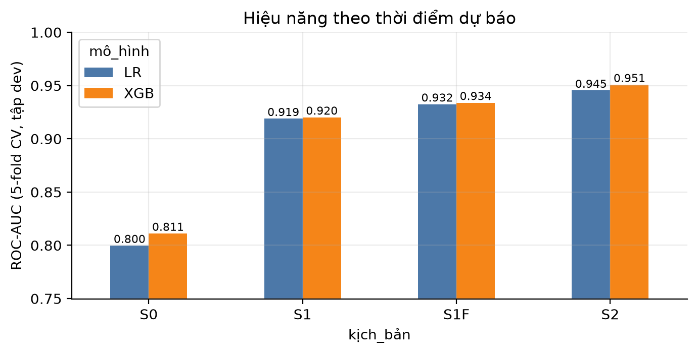{#fig-scenario width=80%}

| Kịch bản | Thời điểm | Số biến | LR ROC-AUC | XGB ROC-AUC | Nhận định |
|---|---|---:|---:|---:|---|
| S0 | Lúc nhập học | 23 | 0,800 | 0,811 | Sớm nhất, chưa có kết quả học tập |
| S1 | Hết kỳ 1, không gồm biến tài chính | 33 | 0,919 | 0,920 | Cân bằng thời điểm và hiệu năng; chọn triển khai |
| S1F | Hết kỳ 1 + tài chính | 37 | 0,932 | 0,934 | Thời điểm đo nợ/học phí không chắc chắn |
| S2 | Hết kỳ 2 + tài chính | 50 | 0,945 | 0,951 | Mốc đối chứng muộn; không phù hợp cảnh báo đầu kỳ 2 |

: So sánh kịch bản dự báo theo thời điểm {#tbl-scenarios}

**Cách đọc @fig-scenario.** Trục ngang là bốn kịch bản; trục dọc là ROC-AUC trung bình qua 5 fold trên Dev. Mỗi kịch bản có hai cột: LR (xanh dương) và XGB (cam), nhãn số ghi trên đầu cột. Lưu ý trục dọc bắt đầu từ 0,75 chứ không phải 0, nên chiều cao cột phóng đại chênh lệch; cần đọc theo giá trị số.

| Bước chuyển | Tăng ROC-AUC (LR) | Tăng ROC-AUC (XGB) | Thông tin thêm |
|---|---:|---:|---|
| S0 $\to$ S1 | +0,119 | +0,109 | Kết quả học kỳ 1 |
| S1 $\to$ S1F | +0,013 | +0,014 | Nợ, học phí (thời điểm đo không rõ) |
| S1 $\to$ S2 | +0,026 | +0,031 | Kết quả học kỳ 2 và tài chính |

: Mức tăng ROC-AUC (CV, Dev) khi thêm thông tin, tính từ @tbl-scenarios {#tbl-delta-auc}

**Quan sát và diễn giải.** S0, chỉ dùng thông tin lúc nhập học, đạt 0,800 (LR) và 0,811 (XGB), cho thấy hồ sơ đầu vào đã có tín hiệu nhưng còn hạn chế. Khi bổ sung kết quả học kỳ 1, S1 tăng lên 0,919 và 0,920, một bước nhảy khoảng 0,11–0,12; đây là bước tăng lớn nhất của cả bốn kịch bản. S1F đạt 0,932 và 0,934, còn S2 đạt 0,945 và 0,951, nhưng mỗi bước thêm chỉ nâng AUC khoảng 0,01–0,03. Phần tăng thêm này đi cùng biến tài chính có thời điểm ghi nhận không chắc chắn hoặc kết quả kỳ 2 đã phát sinh muộn; hiệu năng cao hơn không đồng nghĩa với phù hợp hơn cho cảnh báo sớm. Ngoài ra, hai mô hình LR và XGB gần như ngang nhau ở mọi kịch bản (chênh không quá 0,011 ở S0, 0,001–0,006 ở các kịch bản còn lại), nên lựa chọn kịch bản ảnh hưởng đến hiệu năng nhiều hơn lựa chọn thuật toán. S1 được chọn vì có thể chạy ngay đầu kỳ 2 và còn đủ thời gian để CVHT liên hệ. S0/S1F/S2 là các kịch bản so sánh; chúng không được trộn thành đầu vào của mô hình S1. Giới hạn thông tin theo thời điểm giúp tránh temporal leakage [@kabakchieva2013; @migueis2018].

## Baseline và mô hình mặc định {#sec-baselines}

Các baseline trả lời câu hỏi liệu mô hình phức tạp có cải thiện so với một quy tắc đơn giản hay không. Dummy phản ánh mốc không có năng lực phân biệt, nên AUC bằng 0,5; heuristic chỉ dùng tỷ lệ môn đạt để tạo mốc nghiệp vụ dễ hiểu mà không cần học máy; Logistic Regression mặc định là baseline học máy có điều chuẩn. So sánh này giúp tránh chỉ báo cáo kết quả của mô hình tối ưu nhất.

| Mô hình | ROC-AUC CV | Độ lệch chuẩn | Average Precision CV | Ghi chú |
|---|---:|---:|---:|---|
| Dummy theo tỷ lệ lớp | 0,500 | 0,000 | 0,392 | Mốc ngẫu nhiên |
| Luật một biến `s1_approval_rate` | 0,880 | — | 0,816 | Mốc heuristic |
| Logistic Regression mặc định | 0,919 | 0,008 | 0,908 | Baseline mạnh |

: Các mốc baseline và kết quả cross-validation {#tbl-baselines}

**Diễn giải.** Dummy có AP bằng đúng tỷ lệ lớp dương (0,392), đúng như lý thuyết của mốc ngẫu nhiên. Một luật duy nhất theo tỷ lệ môn đạt đã vượt xa mốc này (AUC 0,880), điều cho thấy phần lớn tín hiệu nằm ở tiến độ học kỳ 1. LR mặc định nâng thêm 0,039 lên 0,919. Đây là baseline mạnh, nên bất kỳ cải thiện nào của mô hình phức tạp hơn đều phải được đối chiếu với khoảng cách 0,008 (độ lệch chuẩn qua fold) trước khi coi là có ý nghĩa.

Ba thuật toán LR, RF và XGB được so sánh trên cùng 33 biến S1 và cùng stratified 5-fold CV. Các baseline là mốc tham chiếu riêng, không nên xem đây là ba thuật toán nâng cao ngang hàng để chọn mô hình cuối. Với tham số mặc định, ROC-AUC CV của LR, RF và XGB lần lượt khoảng 0,919, 0,920 và 0,920, nghĩa là chưa có thuật toán nào vượt trội.

Notebook còn đối chiếu LR với `class_weight=None` và `class_weight="balanced"`. Trên CV, ROC-AUC đều xấp xỉ 0,919; ở ngưỡng 0,50, Recall tăng từ 0,777 lên 0,827 khi cân bằng trọng số lớp. Trọng số lớp chỉ làm thay đổi cách mô hình phạt lỗi, không tạo hồ sơ tổng hợp, nên đồ án không dùng SMOTE. Kết quả này cũng cho thấy việc chọn ngưỡng quan trọng hơn việc cân bằng lớp khi mục tiêu là Recall. Đây là một kiểm tra độ nhạy riêng; mô hình cuối và ngưỡng vận hành vẫn được chọn theo quy trình đánh giá đã mô tả.

## Tinh chỉnh siêu tham số bằng Optuna {#sec-optuna}

Optuna tối ưu ROC-AUC CV cho LR, RF và XGBoost, mỗi thuật toán 25 lượt thử, mỗi lượt đánh giá bằng cùng 5-fold CV trên Dev. Tập Test không tham gia quá trình này. Kết quả CV sau tinh chỉnh lần lượt là 0,9190, 0,9207 và 0,9244 (so với khoảng 0,919, 0,920 và 0,920 khi dùng tham số mặc định).

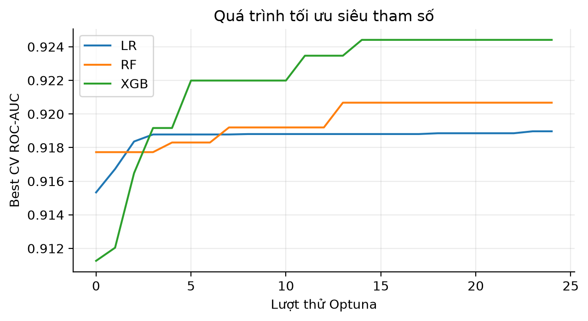{#fig-optuna width=75%}

**Cách đọc @fig-optuna.** Trục ngang là số thứ tự lượt thử Optuna (0 đến 24); trục dọc là ROC-AUC CV *tốt nhất đạt được tính đến lượt đó* (best so far), không phải điểm của từng lượt riêng lẻ, nên mỗi đường chỉ đi lên hoặc đi ngang, tạo dạng bậc thang. Ba đường tương ứng LR (xanh dương), RF (cam) và XGB (xanh lá).

**Quan sát.** Đường LR bắt đầu quanh 0,915, ổn định ở khoảng 0,919 sau vài lượt thử và gần như không đổi nữa. RF bắt đầu cao hơn (khoảng 0,918), cải thiện theo các bậc nhỏ và dừng quanh 0,921. XGBoost bắt đầu thấp nhất (khoảng 0,911), tăng mạnh trong những lượt đầu rồi đạt khoảng 0,9244 sau khoảng giữa quá trình tìm kiếm, sau đó gần như đi ngang. Điều này cho thấy thêm lượt thử ở cuối không tạo cải thiện đáng kể trong không gian tìm kiếm đã định. Kết quả chỉ phản ánh objective và miền siêu tham số của notebook, không chứng minh đã tìm được tối ưu toàn cục.

**Diễn giải.** Tinh chỉnh chỉ có tác dụng đáng kể với XGBoost (khoảng +0,004); với LR, siêu tham số gần như không thay đổi kết quả, phù hợp với việc LR là mô hình ít linh hoạt. Mức chênh giữa ba mô hình sau tinh chỉnh (tối đa 0,0054) nhỏ hơn độ lệch chuẩn qua fold của LR mặc định (0,008), nên trên CV ba mô hình chưa thể được xếp hạng chắc chắn. Đây là cơ sở để dùng các tiêu chí ngoài AUC khi chọn mô hình cuối.

## Quá khớp và quy tắc chọn {#sec-selection}

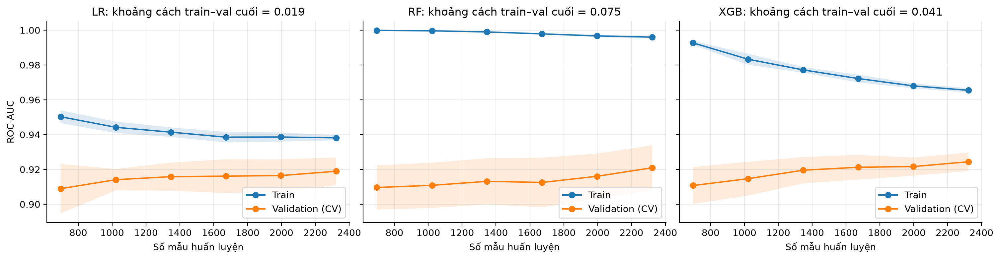{#fig-learning width=90%}

| Mô hình | AUC train | AUC validation | Khoảng cách | Fit trung vị (s) | Độ trễ (ms/hồ sơ) | Kích thước (MiB) |
|---|---:|---:|---:|---:|---:|---:|
| LR | 0,938 | 0,919 | 0,019 | 0,0411 | 0,0131 | 0,0121 |
| RF | 0,996 | 0,921 | 0,075 | 0,2328 | 0,2475 | 2,6088 |
| XGB | 0,965 | 0,924 | 0,041 | 0,3048 | 0,0174 | 0,3926 |

: So sánh độ khớp, tốc độ và kích thước mô hình {#tbl-model-cost}

**Cách đọc @fig-learning.** Ba ô tương ứng LR, RF và XGB. Trục ngang là số mẫu huấn luyện (từ khoảng 700 đến 2.300); trục dọc là ROC-AUC. Đường xanh là AUC trên chính dữ liệu huấn luyện (train), đường cam là AUC trên các fold xác nhận (validation CV); dải màu quanh mỗi đường phản ánh độ dao động giữa các lần/fold. Tiêu đề mỗi ô ghi khoảng cách train–validation ở điểm cuối (0,019; 0,075; 0,041). Khoảng cách lớn và không thu hẹp khi thêm dữ liệu là dấu hiệu quá khớp; hai đường tiến lại gần nhau cho thấy mô hình ổn định.

**Quan sát.** LR có AUC train giảm nhẹ từ khoảng 0,95 về 0,938 trong khi validation tăng và ổn định quanh 0,919, khoảng cách cuối 0,019, nhỏ nhất. RF gần như đạt 1,00 trên train ở mọi cỡ mẫu nhưng validation chỉ quanh 0,91–0,921, tạo gap 0,075 lớn nhất và dấu hiệu overfit rõ nhất. XGBoost giảm train từ khoảng 0,993 về 0,965, còn validation tăng lên 0,924, gap 0,041. Ở cả ba mô hình đường validation vẫn đi lên nhẹ khi tăng số mẫu, gợi ý có thêm dữ liệu sẽ giúp ích.

**Quy tắc chọn mô hình cuối.** Đường cong giúp giải thích vì sao AUC CV cao nhất chưa tự động đồng nghĩa lựa chọn tốt nhất. Quy tắc trong notebook gồm các bước:

1. Tìm AUC CV cao nhất sau tinh chỉnh: 0,9244 (XGB).
2. Giữ các mô hình có AUC CV nằm trong dung sai `AUC_TOL = 0,01` so với mức cao nhất, tức không thấp hơn 0,9144. Cả ba mô hình đều đủ điều kiện (LR 0,9190; RF 0,9207; XGB 0,9244).
3. Trong nhóm đủ điều kiện, xếp theo độ trễ suy luận tăng dần: LR (0,0131 ms) $<$ XGB (0,0174 ms) $<$ RF (0,2475 ms).
4. Nếu hòa, xét kích thước tệp rồi thời gian fit.

Theo quy tắc này LR được chọn: độ trễ thấp nhất và kích thước 0,0121 MiB cũng nhỏ nhất trong ba mô hình, dù AUC CV thấp hơn XGBoost 0,0054. Đây là benchmark trên máy phát triển và không bao gồm giao diện/SHAP; thời gian có thể thay đổi theo môi trường.

**Độ nhạy của quy tắc.** Kết quả phụ thuộc vào `AUC_TOL`. Chênh lệch AUC giữa LR và XGB là 0,0054, nên nếu dung sai đặt nhỏ hơn 0,0054 thì LR bị loại ở bước 2 và XGB sẽ được chọn. Dung sai 0,01 là một lựa chọn thiết kế, gần với độ lệch chuẩn qua fold (0,008) nên có cơ sở thống kê, nhưng cần được nêu rõ. Ngoài ra, chênh lệch độ trễ giữa các mô hình (cao nhất 0,25 ms/hồ sơ) không có ý nghĩa thực tế với lô vài nghìn hồ sơ; ở đây tiêu chí độ trễ đóng vai trò tiêu chí phân định hơn là ràng buộc cứng. Lý do thực chất để ưu tiên LR còn nằm ở tính minh bạch: mô hình tuyến tính có hệ số đọc trực tiếp, SHAP chính xác và nhẹ, kích thước nhỏ, dễ kiểm toán và dễ đóng gói trong ứng dụng. Cái giá là hiệu năng thấp hơn một chút trên tập kiểm thử ([Mục 5.1](#sec-test-perf)), điều mà người quyết định có thể cân nhắc lại.

# Đánh giá, giải thích và đạo đức {#sec-ch5}

## Hiệu năng trên tập kiểm thử {#sec-test-perf}

Mô hình LR tinh chỉnh được fit trên Dev; tập Test 726 hồ sơ được giữ riêng. Bốn nhóm chỉ số trong bảng trả lời các câu hỏi khác nhau (@tbl-metrics): ROC-AUC và Average Precision đo khả năng xếp hạng qua mọi ngưỡng; Precision, Recall và tỷ lệ gắn cờ phụ thuộc ngưỡng đã chọn trên OOF Dev; Accuracy chỉ để tham khảo, không dùng một mình để chọn ngưỡng. Với tỷ lệ lớp không cân bằng hoàn toàn, đường PR giúp quan sát trực tiếp trade-off trên lớp dương [@saito2015; @davis2006].

| Mô hình | ROC-AUC test | Average Precision test | Ngưỡng chọn trên OOF Dev | Accuracy | Precision | Recall | Gắn cờ |
|---|---:|---:|---:|---:|---:|---:|---:|
| LR mặc định | 0,931 | 0,916 | 0,19 | 0,791 | 0,664 | 0,940 | 55,4% |
| LR tinh chỉnh (FINAL) | 0,931 | 0,916 | 0,19 | 0,791 | 0,664 | 0,940 | 55,4% |
| RF tinh chỉnh | 0,936 | 0,924 | 0,22 | 0,826 | 0,718 | 0,915 | 49,9% |
| XGB tinh chỉnh | 0,939 | 0,929 | 0,20 | 0,820 | 0,703 | 0,933 | 51,9% |

: Hiệu năng trên tập kiểm thử độc lập {#tbl-test-results}

**Cách đọc bảng.** Hai cột ROC-AUC và AP so sánh được giữa các mô hình vì không phụ thuộc ngưỡng. Các cột còn lại *không* so sánh trực tiếp được, vì mỗi mô hình dùng ngưỡng riêng chọn trên OOF Dev (0,19; 0,22; 0,20) và do đó gắn cờ số hồ sơ khác nhau (55,4%; 49,9%; 51,9%). Ví dụ Recall của LR (0,940) cao nhất chủ yếu vì LR gắn cờ nhiều hồ sơ hơn, không phải vì LR xếp hạng tốt hơn. LR mặc định và LR tinh chỉnh cho kết quả giống hệt nhau, nhất quán với việc tinh chỉnh gần như không đổi LR ở @fig-optuna.

**So sánh mô hình.** Về xếp hạng, XGB (0,939; AP 0,929) và RF (0,936; AP 0,924) nhỉnh hơn LR (0,931; AP 0,916) lần lượt 0,008 và 0,005 ROC-AUC. Đó là cái giá của việc chọn LR theo quy tắc ở [Mục 4.4](#sec-selection). Vì Test chỉ là một lần chia và chưa có khoảng tin cậy, đồ án không khẳng định các chênh lệch này có ý nghĩa thống kê; đồng thời mức 0,931 của LR vẫn vượt chỉ tiêu tham chiếu 0,90.

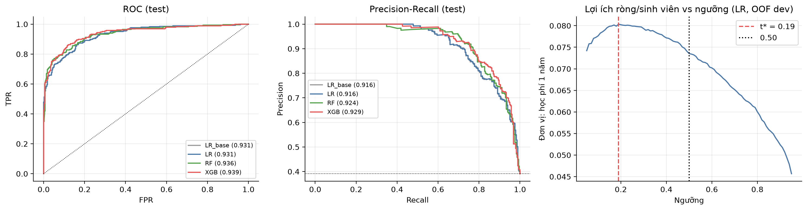{#fig-rocpr width=100%}

**Cách đọc @fig-rocpr.** Hình có ba panel với vai trò khác nhau.

- *Panel trái, đường ROC (Test).* Trục ngang là FPR, trục dọc là TPR (cũng là Recall); mỗi điểm trên đường ứng với một ngưỡng. Đường chéo chấm là xếp hạng ngẫu nhiên (AUC 0,5); đường càng gần góc trên bên trái càng tốt. Chú giải ghi AUC: LR\_base và LR cùng 0,931, RF 0,936, XGB 0,939.
- *Panel giữa, đường Precision–Recall (Test).* Trục ngang là Recall, trục dọc là Precision. Đường nằm ngang gần 0,392 là mốc ngẫu nhiên (tỷ lệ lớp dương trong Test). AP: LR 0,916, RF 0,924, XGB 0,929. Đường bắt đầu ở Precision bằng 1 khi Recall thấp rồi giảm dần: muốn bắt thêm ca nghỉ học phải chấp nhận nhiều báo nhầm hơn.
- *Panel phải, lợi ích ròng trên mỗi sinh viên theo ngưỡng (LR, OOF Dev).* Trục ngang là ngưỡng, trục dọc là $NB$ chia cho số sinh viên, theo đơn vị giá trị một năm học phí. Đường đỏ đứt tại $t^*=0{,}19$ là ngưỡng được chọn; đường đen chấm tại 0,50 là ngưỡng mặc định.

**Quan sát.** Trên ROC test, cả ba đường nằm cao hơn đường chéo ngẫu nhiên và gần chồng lên nhau, nên ba mô hình có khả năng xếp hạng tương tự; ở khoảng FPR 0,05–0,3 đường của RF/XGB nhỉnh hơn LR đôi chút. Trên PR, cả ba cao hơn mốc nền rất xa. Hai panel đầu dùng Test để đánh giá phân biệt/xếp hạng qua nhiều ngưỡng, không chọn ngưỡng. Panel lợi ích ròng dùng dự báo out-of-fold Dev để chọn 0,19 theo giả định $L=1$, $C=0{,}05$, $S=0{,}30$: đường đạt đỉnh khoảng 0,080 gần ngưỡng này, còn khoảng 0,074 tại 0,50 và giảm dần tới khoảng 0,046 ở ngưỡng gần 0,95, vì số ca được cứu giả định giảm nhanh hơn số lượt tư vấn. Đường khá phẳng quanh đỉnh (từ khoảng 0,15 đến 0,30 chỉ chênh vài phần nghìn), nên lựa chọn ngưỡng có thể điều chỉnh theo năng lực CVHT mà tổn thất lợi ích ròng nhỏ. Ngưỡng 0,19 được chọn bằng OOF Dev, không phải bằng cách tối ưu trên Test.

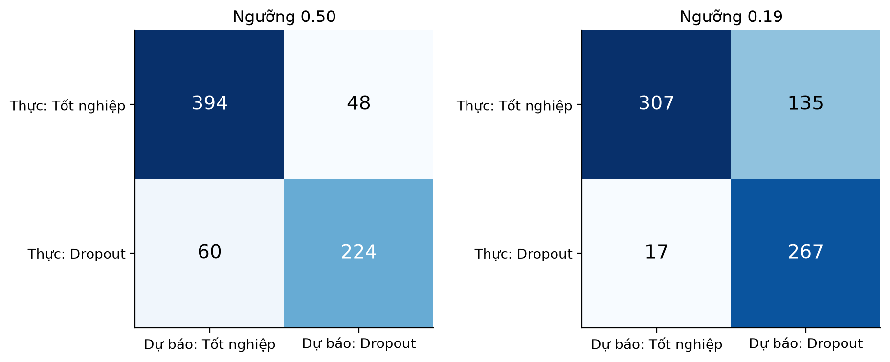{#fig-cm width=70%}

**Cách đọc @fig-cm.** Hai ma trận $2\times2$ cho cùng tập Test, bên trái ở ngưỡng 0,50 và bên phải ở ngưỡng 0,19. Hàng là nhãn thực (Tốt nghiệp ở trên, Dropout ở dưới), cột là dự báo (Tốt nghiệp bên trái, Dropout bên phải); màu xanh càng đậm thì số hồ sơ trong ô càng lớn. Như vậy ô trên-trái là TN, trên-phải là FP, dưới-trái là FN và dưới-phải là TP. Hàng dưới cộng lại là 284 ca Dropout thật, hàng trên cộng lại là 442 ca tốt nghiệp thật.

| Đại lượng | Ngưỡng 0,50 | Ngưỡng 0,19 | Thay đổi |
|---|---:|---:|---|
| TP (bắt được) | 224 | 267 | +43 ca |
| FN (bỏ sót) | 60 | 17 | $-43$ ca |
| FP (báo nhầm) | 48 | 135 | +87 ca |
| TN | 394 | 307 | $-87$ ca |
| Số hồ sơ gắn cờ | 272 (37,5%) | 402 (55,4%) | +130 hồ sơ |
| Recall | 78,9% | 94,0% | tăng |
| Precision | 82,4% | 66,4% | giảm |
| FPR | 10,9% | 30,5% | tăng |
| Accuracy | 85,1% | 79,1% | giảm |

: Chỉ số tại hai ngưỡng trên tập kiểm thử (tính từ @fig-cm) {#tbl-two-thresholds}

**Diễn giải.** Hạ ngưỡng từ 0,50 xuống 0,19 bắt thêm 43 ca nghỉ học (giảm số ca bị bỏ sót từ 60 xuống 17) nhưng phải gắn cờ thêm 130 hồ sơ, trong đó 87 là báo nhầm: tức mỗi ca nghỉ học bắt thêm "tốn" khoảng 3 hồ sơ cần rà soát thêm, trong đó khoảng 2 là báo nhầm. Accuracy giảm từ 85,1% xuống 79,1% dù mô hình hữu ích hơn theo hàm lợi ích (@tbl-nb-example); đây là lý do không dùng Accuracy một mình để chọn ngưỡng. Trong 402 hồ sơ bị gắn cờ ở 0,19, cứ 100 hồ sơ có khoảng 66 ca nghỉ học thật; trong 324 hồ sơ không bị gắn cờ, khoảng 95% (307/324) thật sự không nghỉ học. Biểu đồ thể hiện đúng đánh đổi giữa bỏ sót và khối lượng rà soát; chọn ngưỡng cuối cùng cần căn cứ năng lực tư vấn.

## Hai ngưỡng quyết định và phân tầng {#sec-thresholds}

**Phân tầng sử dụng trong ứng dụng.** Ứng dụng dùng hai ngưỡng để chia hồ sơ thành ba mức:

| Mức | Điều kiện | Ý nghĩa với CVHT |
|---|---|---|
| Xanh | $p<0{,}19$ | Theo dõi thông thường |
| Vàng | $0{,}19\le p<0{,}62$ | Cần CVHT xem lại hồ sơ |
| Đỏ | $p\ge0{,}62$ | Ưu tiên liên hệ sớm |

: Ba mức ưu tiên và hai ngưỡng {#tbl-tiers}

Ngưỡng Đỏ 0,62 được xác định trên OOF Dev là ngưỡng đầu tiên phía trên ngưỡng lợi ích ròng đạt Precision ít nhất 0,90. Vì vậy cần phân biệt ngưỡng nhị phân 0,19, dùng để tính Recall và quyết định "có cần xem xét hay không", với mức Đỏ 0,62, dùng để ưu tiên khẩn hơn. Hai ngưỡng phục vụ hai mục đích khác nhau: 0,19 đánh dấu cần xem xét trong bài toán nhị phân, còn 0,62 dành thứ tự ưu tiên liên hệ. Ngưỡng triển khai được lưu trong `models/artifacts/meta.json` và ứng dụng chỉ đọc chứ không tự tính lại.

### Phân tích ngưỡng và hàm lợi ích {#sec-threshold-benefit}

Ngưỡng 0,50 là quy ước phân loại mặc định chứ không nhất thiết phù hợp với mục tiêu can thiệp. Ngưỡng 0,19 được tối ưu trên dự báo out-of-fold của Dev theo hàm lợi ích ròng với ba tham số chuẩn hóa $L=1$, $C=0{,}05$ và $S=0{,}30$ ([Mục 1.6](#sec-benefit)). Tại ngưỡng thấp hơn, hệ thống bắt được nhiều trường hợp hơn nhưng cũng chuyển thêm hồ sơ cho CVHT. Giá trị $S$ chưa được đo bằng thử nghiệm thực địa, vì vậy kết quả net benefit/ROI là phân tích kịch bản, không phải lợi ích tài chính đã quan sát.

Để thấy ngưỡng nhạy với giả định đến mức nào, @tbl-threshold-sens tính ngưỡng lý thuyết $C/(SL)$ cho vài tổ hợp tham số (với điều kiện xác suất mô hình được hiệu chỉnh tốt; đồ án chưa đánh giá hiệu chỉnh xác suất).

| $C$ | $S=0{,}20$ | $S=0{,}30$ | $S=0{,}50$ |
|---|---:|---:|---:|
| 0,05 | 0,25 | 0,17 | 0,10 |
| 0,10 | 0,50 | 0,33 | 0,20 |

: Ngưỡng lý thuyết $C/(SL)$ với $L=1$ {#tbl-threshold-sens}

Bảng cho thấy nếu chi phí tư vấn gấp đôi ($C=0{,}10$) hoặc hiệu quả can thiệp thấp hơn ($S=0{,}20$), ngưỡng hợp lý dịch lên đáng kể, tức hệ thống nên gắn cờ ít hơn. Điều này giải thích vì sao ngưỡng phải được tính lại bằng số liệu thật của trường trước khi triển khai. Năng lực thực tế của đội CVHT cũng cần được dùng để hiệu chỉnh lại cả hai mức 0,19 và 0,62.

## Giải thích dự báo {#sec-shap-eval}

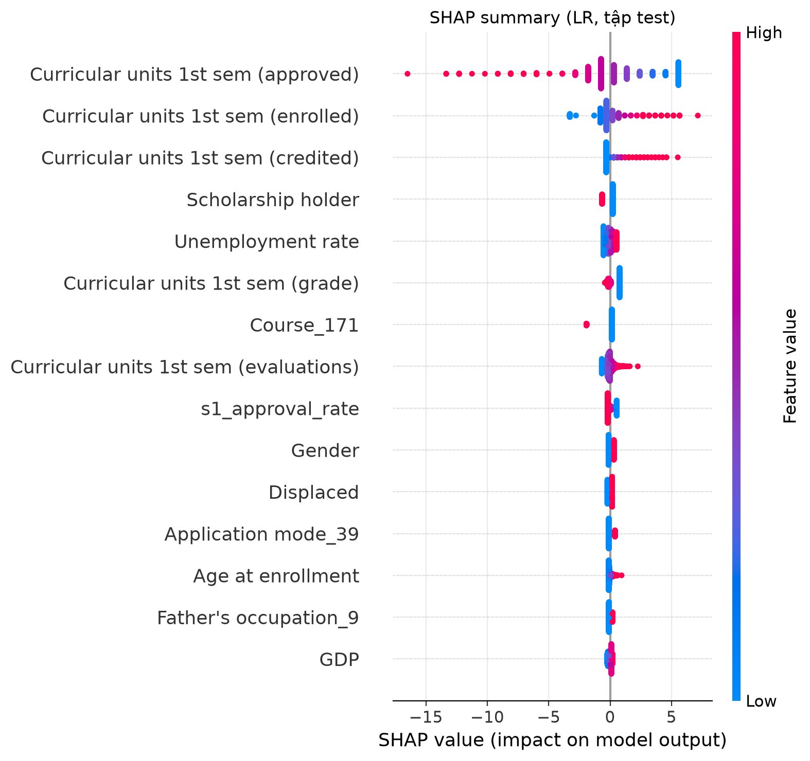{#fig-shap width=75%}

**Cách đọc @fig-shap.** Đây là biểu đồ beeswarm SHAP toàn cục của LR trên Test. Mỗi chấm là một hồ sơ. Trục ngang là giá trị SHAP: đóng góp của đặc trưng vào đầu ra mô hình so với nền; chấm nằm bên phải số 0 đẩy đầu ra theo hướng Dropout, bên trái kéo ngược lại. Màu của chấm là giá trị của đặc trưng, từ thấp (xanh) đến cao (đỏ). Các đặc trưng được sắp từ trên xuống theo mức đóng góp trung bình tuyệt đối. Chấm xếp chồng theo chiều dọc ở nơi có nhiều hồ sơ có cùng đóng góp, nên các biến nhị phân tạo thành hai cụm. Như đã nêu ở [Mục 2.6](#sec-shap-theory), thang trục cho thấy đầu ra là log-odds.

**Quan sát.** `Curricular units 1st sem (approved)` đứng đầu và trải rộng nhất: các giá trị cao (đỏ) chủ yếu nằm ở phía SHAP âm, còn giá trị thấp (xanh) trải về phía dương, nghĩa là trong mô hình này số môn đạt cao thường kéo giảm đầu ra Dropout, còn số môn đạt thấp thường đẩy đầu ra lên. Các vị trí tiếp theo là số môn đăng ký kỳ 1, số môn được công nhận tín chỉ, học bổng và điểm kỳ 1. Các điểm tập trung sát 0 cho thấy một số biến có đóng góp nhỏ ở nhiều hồ sơ, dù có thể quan trọng với một số trường hợp riêng. Dấu SHAP được đọc theo trục tác động vào đầu ra của mô hình; không đồng nhất giá trị âm với "xấu" nếu chưa xác định lớp đích.

| Biến | Giá trị cao (đỏ) có xu hướng | Ghi chú khi đọc |
|---|---|---|
| Số môn đạt kỳ 1 | Kéo đầu ra xuống (SHAP âm), mạnh nhất | Phù hợp tương quan $\rho\approx-0{,}62$ ở EDA |
| Số môn đăng ký kỳ 1 | Đẩy đầu ra lên (SHAP dương) | Đọc cùng số môn đạt: đăng ký nhiều nhưng đạt ít là tổ hợp rủi ro; hai biến tương quan nên chia sẻ đóng góp |
| Số môn được công nhận tín chỉ kỳ 1 | Đẩy đầu ra lên | Chiều tác động cần kiểm tra thêm vì nhóm biến kỳ 1 tương quan với nhau |
| `Scholarship holder` | Có học bổng kéo đầu ra xuống | Nhất quán với EDA, nhưng không chứng minh học bổng là nguyên nhân |
| Điểm kỳ 1 | Điểm cao kéo đầu ra xuống | Hợp lý về nghiệp vụ |
| `Unemployment rate` (vĩ mô) | Đẩy đầu ra lên nhẹ | Biến chỉ có 9–10 giá trị, có thể đại diện cho khóa/năm; không diễn giải như tín hiệu cấp cá nhân |

: Một số đặc trưng nổi bật trong @fig-shap và cách đọc (mô tả từ hình, không mang ý nghĩa nhân quả) {#tbl-shap-features}

**Thận trọng.** SHAP cho thấy mô hình đã sử dụng biến như thế nào; nó không chứng minh biến gây ra nghỉ học, và các biến tương quan có thể chia sẻ phần đóng góp [@lundberg2017]. Việc `Unemployment rate` và `GDP` xuất hiện trong nhóm biến đầu bảng là lý do để thận trọng: do ít mức giá trị, chúng có thể thay cho khóa tuyển sinh hoặc năm học, và đóng góp của chúng khó tách khỏi hiệu ứng khóa học. Giải thích cục bộ cho từng hồ sơ trong ứng dụng được trình bày ở [Mục 6.1](#sec-app).

## Công bằng, quyền riêng tư và rủi ro {#sec-fairness-eval}

@tbl-fairness báo cáo giới tính, ba nhóm tuổi và học bổng trong Test tại ngưỡng 0,19. Các lát cắt khác (quốc tế, displaced, nhu cầu giáo dục đặc biệt, hôn nhân) cũng được tính trong notebook; nhóm có ít ca dương/âm không đưa vào bảng chính vì chỉ số thiếu ổn định. Các giá trị chưa kèm khoảng tin cậy hay kiểm định thống kê.

| Nhóm | n | Tỷ lệ Dropout | Ca Dropout (ước tính) | Tỷ lệ gắn cờ | Recall | FPR |
|---|---:|---:|---:|---:|---:|---:|
| Nữ | 438 | 29,7% | 130 | 44,1% | 92,3% | 23,7% |
| Nam | 288 | 53,5% | 154 | 72,6% | 95,5% | 46,3% |
| Có học bổng | 174 | 14,9% | 26 | 24,7% | 88,5% | 13,5% |
| Không học bổng | 552 | 46,7% | 258 | 65,0% | 94,6% | 39,1% |
| Tuổi $\le 19$ | 318 | 24,8% | 79 | 39,6% | 84,8% | 24,7% |
| Tuổi 20–24 | 221 | 36,2% | 80 | 57,0% | 96,2% | 34,8% |
| Tuổi $\ge 25$ | 187 | 66,8% | 125 | 80,2% | 98,4% | 43,5% |

: Chỉ số theo nhóm tại ngưỡng 0,19 {#tbl-fairness}

Cột "Ca Dropout (ước tính)" được tính bằng $n\times$ tỷ lệ Dropout, làm tròn; tổng theo mỗi cách chia đều bằng 284, khớp với số ca Dropout thật trong Test.

**Quan sát.** FPR ở nam (46,3%) cao gần gấp đôi nữ (23,7%), và ở nhóm không học bổng (39,1%) cao gần gấp ba nhóm có học bổng (13,5%): các nhóm này bị gọi nhầm nhiều hơn. Theo tuổi, Recall tăng dần theo nhóm tuổi (84,8%; 96,2%; 98,4%) nhưng FPR cũng tăng (24,7%; 34,8%; 43,5%). Chiều ngược lại cũng cần chú ý: các nhóm có Recall thấp nhất là tuổi $\le 19$ (84,8%) và nhóm có học bổng (88,5%), nghĩa là sinh viên nghỉ học thuộc các nhóm này dễ bị bỏ sót hơn. Một phần của chênh lệch FPR và tỷ lệ gắn cờ đi cùng chênh lệch tỷ lệ nền: nhóm có tỷ lệ Dropout cao hơn thì mô hình cũng gắn cờ nhiều hơn.

**Độ bất định.** Các chênh lệch này dựa trên một lần chia Test và cỡ mẫu nhỏ ở một số nhóm. Ví dụ nhóm có học bổng chỉ có khoảng 26 ca Dropout, nên Recall 88,5% tương ứng 23/26; chỉ cần sai một ca là con số đổi khoảng 3,8 điểm phần trăm. Nhóm tuổi $\le 19$ có khoảng 79 ca Dropout. Notebook chưa tính khoảng tin cậy hay kiểm định ý nghĩa thống kê, nên đây là tín hiệu cần điều tra chứ chưa chứng minh thiên vị. Các khái niệm demographic parity và equalized odds thường xung đột khi tỷ lệ nền khác nhau [@mehrabi2021; @barocas2023]. Các nhóm nhỏ (ví dụ sinh viên quốc tế, nhu cầu giáo dục đặc biệt) có số quan sát quá thấp để kết luận đáng tin.

**Về việc dùng thuộc tính nhạy cảm làm đầu vào.** Giới tính và tuổi nhập học nằm trong 33 biến của S1 và xuất hiện trong biểu đồ SHAP. Báo cáo không thực hiện thí nghiệm loại các biến này để so sánh; đây là một hướng cần làm trước khi triển khai ([Mục 6.3](#sec-limits)). Dù thế nào, các biến này không được dùng để hạn chế cơ hội hay quyền lợi của sinh viên.

| Rủi ro | Biểu hiện có thể xảy ra | Biện pháp đề xuất |
|---|---|---|
| Gán nhãn cho cá nhân | Điểm rủi ro bị hiểu như đánh giá năng lực hay thái độ | Dùng điểm để ưu tiên liên hệ; CVHT xác minh hoàn cảnh; nêu rõ trong giao diện và tuyên bố giới hạn |
| Báo nhầm tập trung ở một số nhóm | FPR cao ở nam, nhóm không học bổng | Theo dõi FPR và Recall theo nhóm với khoảng tin cậy; xem xét lại ngưỡng khi có dữ liệu thật |
| Bỏ sót ở nhóm nhỏ | Recall thấp ở tuổi $\le 19$, nhóm có học bổng | Báo cáo kèm cỡ mẫu; bổ sung kênh nhận diện khác ngoài mô hình |
| Lộ dữ liệu học tập | Danh sách xuất chứa thông tin cá nhân nhạy cảm | Giới hạn truy cập, dùng mã định danh thay tên, đặt thời hạn lưu trữ |
| Tự động hóa quyết định | Kết quả bị dùng để từ chối quyền lợi | Cấm dùng điểm để quyết định kỷ luật, thôi học, học bổng; giữ con người trong vòng quyết định |

: Rủi ro chính và biện pháp giảm thiểu {#tbl-risk}

Dữ liệu học tập và tài chính cần được giới hạn quyền truy cập, ưu tiên mã định danh thay cho tên trong danh sách chia sẻ, và có thời hạn lưu trữ rõ ràng. Hệ thống phải minh bạch mục đích, có cơ chế để CVHT kiểm tra và sửa dữ liệu, và không tự động quyết định kỷ luật, thôi học hay học bổng. Các nguyên tắc giám sát con người, quyền riêng tư và đánh giá tác động phù hợp với Khuyến nghị Đạo đức AI của UNESCO [@unesco2021].

# Nguyên mẫu, triển khai và hướng phát triển {#sec-ch6}

## Ứng dụng mẫu {#sec-app}

Ứng dụng Streamlit là prototype chuyển pipeline đã huấn luyện sang luồng hỗ trợ quyết định, chưa phải hệ thống tích hợp với SIS hay dịch vụ triển khai an toàn cho dữ liệu thật. Khi khởi động, `load_artifacts()` nạp `models/artifacts/model.joblib`, `models/artifacts/meta.json` (cột mô hình cần, trường raw, giá trị mặc định, nhãn ngành, ngưỡng) và `models/artifacts/background.csv` cho SHAP; `st.cache_resource` giữ mô hình trong bộ nhớ để không nạp lại ở mỗi lần tương tác. Thiếu tệp models/artifacts thì app dừng và báo cần chạy notebook. `T_LOW` và `T_HIGH` được đọc từ metadata, app không tự tính lại ngưỡng. Hàm `predict()` gọi `dropout_utils.add_features()`, chọn đúng 33 cột S1 theo metadata rồi lấy xác suất lớp Dropout từ `predict_proba()`. Hàm `tier_of()` áp dụng Xanh nếu $p<0{,}19$, Vàng nếu $0{,}19\le p<0{,}62$, Đỏ nếu $p\ge0{,}62$. Màu, nhãn và danh sách hành động là quy tắc nội dung do tác giả định nghĩa trong `TIER_STYLE`/`ACTIONS`, không phải mô hình sinh ra. Giao diện chia thành ba tab theo nhiệm vụ (danh sách cần ưu tiên, đánh giá một hồ sơ, thông tin mô hình); màu Đỏ/Vàng/Xanh luôn đi kèm chữ để không phụ thuộc riêng vào màu, và giao diện dùng màu theo biến theme của Streamlit để đọc được ở cả chế độ sáng lẫn tối.

1. **Một hồ sơ:** nhập thông tin đầu vào và kỳ 1, hiển thị xác suất, mức ưu tiên, gợi ý CVHT và biểu đồ SHAP.
2. **What-if:** thay đổi giả định số môn đạt để xem đầu ra mô hình đổi thế nào; mô phỏng không chứng minh tác động can thiệp thực tế.
3. **Chấm điểm hàng loạt:** tải CSV, xếp hồ sơ theo xác suất, xuất tệp kết quả. Danh sách `Enrolled` hiện có 794 hồ sơ và được lưu tại `outputs/Danh_Sach_Can_Thiep.csv`.

### Giao diện và các luồng thao tác {#sec-app-ui}

Ảnh chụp dưới đây là minh chứng từ phiên chạy ứng dụng, đi theo hành trình của CVHT: nhận danh sách, chọn ưu tiên, hiểu lý do, liên hệ và ghi nhận. Giao diện dùng nền tối theo cấu hình chụp; các con số trong ảnh minh họa tương tác và không thay thế bảng đánh giá trên tập test.

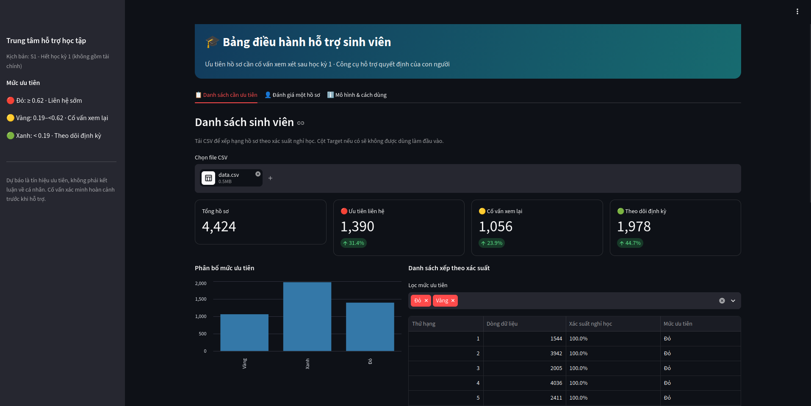{#fig-app-dashboard width=88%}

**Cách đọc @fig-app-dashboard.** Thanh bên trái nhắc kịch bản đang dùng (S1, hết học kỳ 1, không gồm tài chính) và chú giải ba mức ưu tiên cùng ngưỡng (Đỏ $\ge0{,}62$, Vàng 0,19 đến dưới 0,62, Xanh $<0{,}19$), kèm dòng lưu ý rằng đây là tín hiệu ưu tiên chứ không phải kết luận về cá nhân. Phần chính có tiêu đề "Bảng điều hành hỗ trợ sinh viên" và ba tab. Ở tab đang mở, khối chọn tệp cho phép tải CSV (ở đây là `data.csv`). Bốn thẻ phía dưới ghi tổng số hồ sơ (4.424) và số hồ sơ theo mức: 1.390 Đỏ (31,4%), 1.056 Vàng (23,9%), 1.978 Xanh (44,7%). Bên dưới, biểu đồ cột đếm từng mức, và bên phải là bảng xếp hạng với bộ lọc mức ưu tiên (mặc định chọn Đỏ và Vàng) cùng các cột thứ hạng, dòng dữ liệu, xác suất nghỉ học, mức ưu tiên.

**Lưu ý về số liệu trong hình.** App thử đọc CSV dấu chấm phẩy rồi dấu phẩy, chuẩn hóa tên cột không phân biệt chữ hoa/thường, và không đưa `Target` vào đặc trưng đầu vào. Nếu thiếu trường, `prepare_for_scoring()` điền giá trị mặc định/trung vị từ metadata và hiện cảnh báo; ô thiếu hoặc không chuyển được sang số cũng được thay bằng mặc định. Trong ảnh có 4.424 dòng đầu vào minh họa (toàn bộ bộ dữ liệu, gồm cả hồ sơ đã dùng để huấn luyện), vì vậy số thẻ trong ảnh không phải hiệu năng test và cũng không phải chỉ 794 `Enrolled`. Bảng trên màn hình giới hạn 300 dòng đầu sau lọc; tệp xuất CSV chứa toàn bộ kết quả. Nếu file có `student_id`/mã sinh viên, cột nhận diện được giữ để đối chiếu; nếu không, app đánh số dòng. Mười dòng đầu của bảng đều hiển thị xác suất 100,0%: khi xác suất sát 1, các hồ sơ hòa nhau ở một chữ số thập phân và thứ tự giữa chúng không mang ý nghĩa. Nên hiển thị nhiều chữ số hơn hoặc xếp theo điểm log-odds nếu cần phân biệt trong nhóm Đỏ.

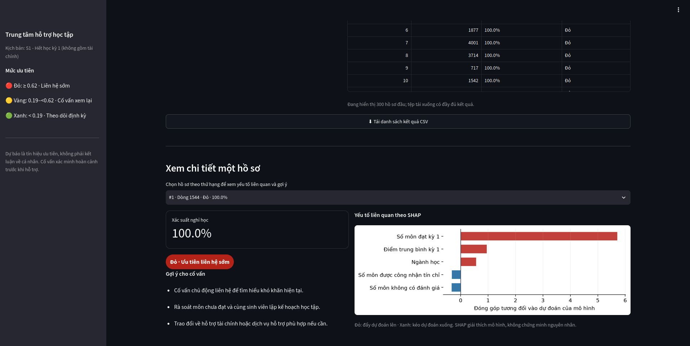{#fig-app-batch-detail width=88%}

**Cách đọc @fig-app-batch-detail.** Phần này tiếp nối bảng ở hình trước: dòng chữ nhỏ ghi bảng chỉ hiển thị 300 dòng đầu và có nút tải toàn bộ kết quả. Mục "Xem chi tiết một hồ sơ" có ô chọn hồ sơ theo thứ hạng (ví dụ hạng 1, dòng 1544, Đỏ, 100,0%). Bên trái là thẻ xác suất nghỉ học, nhãn "Đỏ, ưu tiên liên hệ sớm" và ba gợi ý cho cố vấn (chủ động liên hệ tìm hiểu khó khăn; rà soát môn chưa đạt và lập kế hoạch học tập; trao đổi về hỗ trợ tài chính hoặc dịch vụ hỗ trợ khi cần). Bên phải là biểu đồ thanh ngang SHAP cho năm yếu tố lớn nhất, thanh đỏ đẩy dự đoán lên, thanh xanh kéo xuống.

**Quan sát.** Với hồ sơ này, yếu tố đóng góp lớn nhất là số môn đạt kỳ 1 (thanh đỏ dài nhất, xấp xỉ 5,5 trên trục), tiếp theo là điểm trung bình kỳ 1 và ngành học; số môn được công nhận tín chỉ và số môn không có đánh giá là hai thanh xanh nhỏ. Cách đọc này đúng với thông tin ở mục SHAP toàn cục. App chỉ tính SHAP khi mở hồ sơ, không chạy giải thích cho toàn bộ CSV cùng lúc để tránh tăng thời gian xử lý. Nút tải CSV xuất thứ hạng, xác suất, mức ưu tiên và một gợi ý đầu tiên; tệp không chứa SHAP cho mọi dòng. SHAP giải thích đầu ra theo nền tham chiếu của mô hình, không xác định nguyên nhân cá nhân.

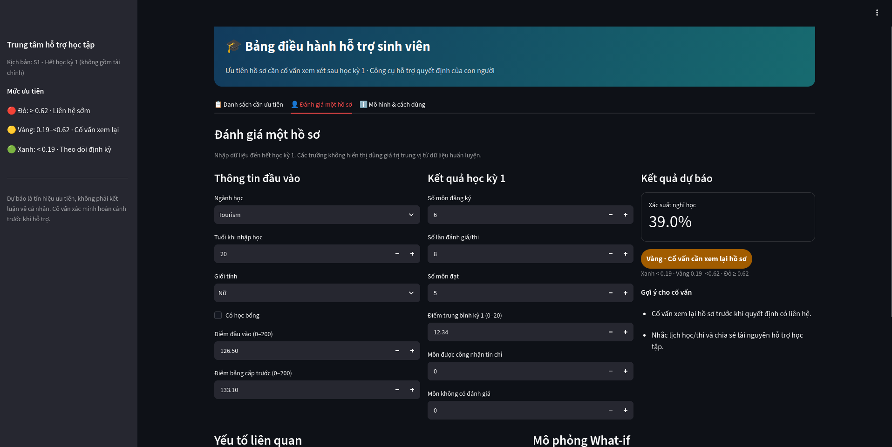{#fig-app-single width=88%}

**Cách đọc @fig-app-single.** Tab "Đánh giá một hồ sơ" chia làm ba cột. Cột trái "Thông tin đầu vào" gồm ngành học, tuổi khi nhập học, giới tính, ô tích học bổng, điểm đầu vào (0–200) và điểm bằng cấp trước (0–200). Cột giữa "Kết quả học kỳ 1" gồm số môn đăng ký, số lần đánh giá, số môn đạt, điểm trung bình kỳ 1 (0–20), số môn được công nhận tín chỉ và số môn không có đánh giá. Cột phải "Kết quả dự báo" hiển thị xác suất, nhãn mức ưu tiên và gợi ý cho cố vấn.

**Ví dụ trong hình.** Hồ sơ ví dụ là ngành Tourism, 20 tuổi, nữ, không học bổng, đăng ký 6 môn, có 8 lượt đánh giá, đạt 5 môn, điểm kỳ 1 là 12,34; hệ thống trả xác suất 39,0%, mức Vàng ("cố vấn cần xem lại hồ sơ") và hai gợi ý nhắc lịch học/thi, chia sẻ tài nguyên hỗ trợ học tập. Ví dụ cho thấy một sinh viên đạt 5/6 môn vẫn ở mức Vàng vì ngưỡng 0,19 khá thấp; nó cũng phù hợp với việc 55,4% hồ sơ Test bị gắn cờ ở ngưỡng này ([Mục 5.2](#sec-thresholds)).

**Giới hạn của hồ sơ nhập tay.** App yêu cầu CVHT nhập các trường dễ xác minh như ngành, tuổi, giới tính, học bổng, điểm đầu vào và tiến độ kỳ 1; các trường raw khác mà LR sử dụng nhưng không có trên form nhận giá trị mặc định từ metadata. Vì vậy đây là hồ sơ đầu vào một phần, không phải toàn bộ 33 biến được quan sát ở mỗi người, và một phần của xác suất hiển thị đến từ giá trị mặc định. App hiển thị xác suất, mức ưu tiên và các bước gợi ý; nếu số môn đạt lớn hơn số môn đăng ký, giao diện cảnh báo kiểm tra dữ liệu.

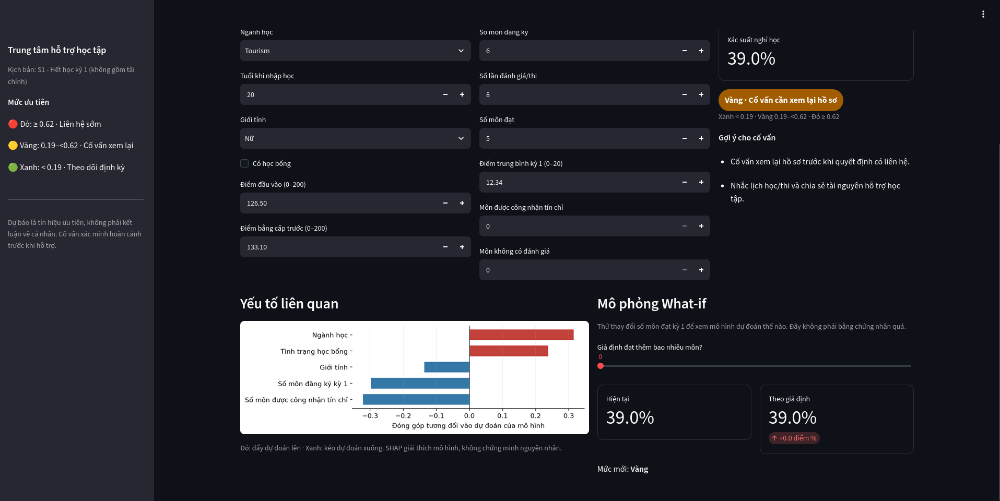{#fig-app-whatif width=88%}

**Cách đọc @fig-app-whatif.** Phần dưới của cùng tab có hai khối cạnh nhau. Khối trái "Yếu tố liên quan" là biểu đồ SHAP cục bộ cho hồ sơ vừa nhập: thanh đỏ đẩy đầu ra theo hướng nguy cơ, thanh xanh kéo theo hướng ngược lại (theo chú giải của app). Khối phải "Mô phỏng What-if" có thanh trượt "Giả định đạt thêm bao nhiêu môn?", và hai thẻ so sánh "Hiện tại" với "Theo giả định" kèm mức ưu tiên mới.

**Quan sát.** Với hồ sơ ví dụ, ngành học và tình trạng học bổng là hai yếu tố đẩy lên, trong khi giới tính, số môn đăng ký kỳ 1 và số môn được công nhận tín chỉ kéo xuống. Thanh trượt đang ở 0 nên xác suất theo giả định bằng hiện tại (cùng 39,0%) và mức vẫn là Vàng. Thanh trượt chỉ cho giả định số môn đạt tăng từ giá trị hiện tại đến số môn đăng ký tối đa; app chạy lại `predict_proba()` rồi so sánh xác suất và tầng hiện tại với giả định. Vì `predict()` gọi `add_features()`, các biến tỷ lệ như `s1_approval_rate` nhiều khả năng được tính lại theo giá trị giả định. Đây là phép thay đổi một đầu vào trong mô hình, không mô phỏng quan hệ nhân quả hay bảo đảm một biện pháp hỗ trợ ngoài đời sẽ làm điểm tăng/giảm tương tự.

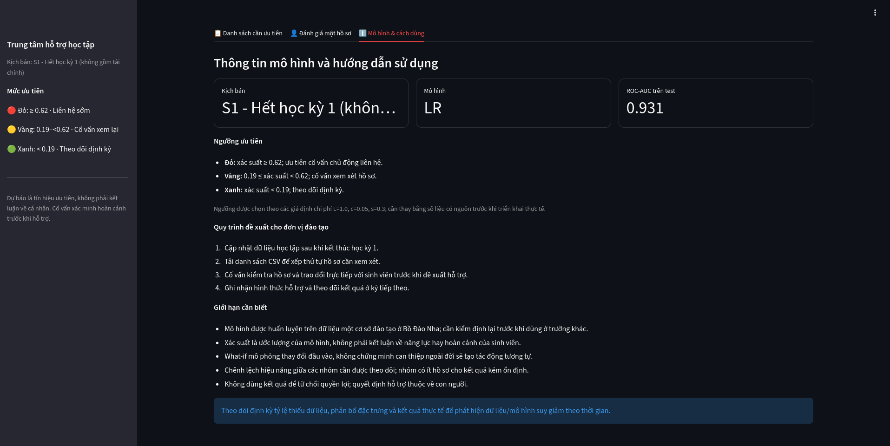{#fig-app-guide width=88%}

**Cách đọc @fig-app-guide.** Tab thứ ba có ba thẻ trên cùng: kịch bản (S1, hết học kỳ 1, không gồm tài chính), mô hình (LR) và ROC-AUC trên test (0,931). Bên dưới là bốn khối chữ: cách đọc ba ngưỡng ưu tiên kèm lưu ý các giả định $L$, $c$, $s$ cần được thay bằng số liệu có nguồn trước khi triển khai; quy trình đề xuất cho đơn vị đào tạo (cập nhật dữ liệu sau kỳ 1, tải và chấm danh sách, cố vấn rà soát và liên hệ, ghi nhận hỗ trợ và theo dõi kết quả); các giới hạn cần biết; và khung thông báo xanh nhắc theo dõi phân bố dữ liệu và kết quả để nhận biết suy giảm theo thời gian. Phần nhắc drift chỉ là hướng dẫn theo dõi; app hiện không tự tính PSI, không tự giám sát drift, không có xác thực người dùng, phân quyền hay nhật ký truy cập. Đây là giới hạn quan trọng khi chuyển từ prototype sang dữ liệu cá nhân của trường.

Các dự báo trên `Enrolled` chưa thể đánh giá vì nhãn kết quả cuối chưa quan sát. Đây là dạng kiểm duyệt nhãn: nhóm này có thể gồm sinh viên tiếp tục học, tốt nghiệp sau đó hoặc rời trường. Do đó danh sách hiện tại chỉ phục vụ minh họa quy trình và cần theo dõi đến khi có kết quả cuối.

<!-- TODO trước khi nộp: chèn URL app online hoặc tên tệp video demo 2-3 phút (theo rubric) vào Phụ lục D. -->

## Quy trình vận hành đề xuất {#sec-workflow}

| Thời điểm | Đơn vị phụ trách | Hoạt động | Bằng chứng cần ghi nhận |
|---|---|---|---|
| Sau khi khóa điểm kỳ 1 | Phòng đào tạo | Trích xuất, kiểm tra định dạng, phạm vi và quyền sử dụng dữ liệu | Biên bản kiểm tra dữ liệu, số dòng và trường thiếu |
| Trước khi gửi danh sách | Quản trị hệ thống / nhóm phân tích | Chạy chấm điểm, kiểm tra phân phối xác suất và lỗi pipeline | Phiên bản mô hình, ngày chạy, số hồ sơ mỗi tầng |
| Đầu kỳ 2 | CVHT | Rà soát dữ liệu, chọn thứ tự liên hệ, ghi nhận hỗ trợ | Nhật ký liên hệ tối thiểu cần thiết, không chia sẻ rộng |
| Cuối kỳ 2 và cuối năm | Phòng đào tạo / nhóm đánh giá | Đối chiếu nhãn cuối, đo hiệu năng và chênh lệch nhóm | Báo cáo metric, khoảng tin cậy và kết quả hỗ trợ |

: Quy trình triển khai và giám sát đề xuất {#tbl-deployment}

Thí điểm nên bắt đầu ở chế độ "shadow": tạo điểm nhưng chưa dùng điểm để quyết định thứ tự hỗ trợ; CVHT xử lý theo quy trình hiện tại trong khi nhóm đánh giá chất lượng dữ liệu, độ hiệu chỉnh, tải cảnh báo và chênh lệch theo nhóm. Sau giai đoạn này, đơn vị mới cân nhắc một thử nghiệm có giám sát và tiêu chí dừng rõ ràng. Chế độ shadow cho phép đo hiệu năng thật mà chưa làm thay đổi hành vi hỗ trợ, nên nhãn cuối không bị nhiễu bởi chính can thiệp. Các chỉ số cần theo dõi gồm phân bố xác suất và tỷ lệ từng mức, Recall/Precision theo nhãn cuối (kể cả theo nhóm), số hồ sơ gắn cờ so với năng lực CVHT, và tỷ lệ thiếu dữ liệu.

Theo dõi dịch chuyển dữ liệu và concept drift theo khóa học là cần thiết khi mô hình cập nhật định kỳ [@gama2014]. Không nên huấn luyện lại hàng năm chỉ vì lịch; cần xem chất lượng nhãn, thay đổi chương trình, hiệu năng tổng thể và theo nhóm, cùng tác động của các can thiệp. Nếu can thiệp thay đổi kết quả, cần ghi nhận để đánh giá và tránh học nhầm quan hệ từ dữ liệu đã qua can thiệp.

## Hạn chế và hướng nghiên cứu {#sec-limits}

| Hạn chế | Ảnh hưởng | Hướng khắc phục |
|---|---|---|
| Dữ liệu từ một cơ sở tại Bồ Đào Nha | Chưa chứng minh khái quát sang trường khác hoặc Việt Nam | Kiểm định ngoài mẫu tại cơ sở mục tiêu |
| Chia Dev/Test ngẫu nhiên theo hồ sơ | Không mô phỏng việc dự báo cho khóa mới | Kiểm định theo khóa tuyển sinh/năm học |
| Thời điểm ghi nhận nợ/học phí không rõ | Hai biến bị loại khỏi S1; thời điểm của `Scholarship holder` cũng cần xác minh | Làm rõ quy trình ghi nhận dữ liệu tại trường |
| Không có dữ liệu LMS, chuyên cần, tương tác tư vấn | Không dự báo sớm hơn học kỳ 1 | Bổ sung dữ liệu hành vi hợp lệ |
| Bỏ `Enrolled` khi huấn luyện | Khác biệt giữa nhóm có nhãn cuối và nhóm đang học; hiệu năng trên nhóm đang học chưa biết | Theo dõi đến khi có nhãn cuối, huấn luyện lại có kiểm soát |
| Tham số $L$, $C$, $S$ là giả định | Ngưỡng 0,19 và 0,62 có thể lệch | Nghiên cứu người dùng, số liệu vận hành, thử nghiệm đối chứng |
| Chưa đánh giá hiệu chỉnh xác suất | Xác suất hiển thị có thể không khớp tần suất thực | Biểu đồ hiệu chỉnh và hiệu chỉnh xác suất |
| Fairness dùng một lần chia Test, nhóm nhỏ, không có khoảng tin cậy | Chênh lệch giữa nhóm chưa kết luận được | Khoảng tin cậy (bootstrap), lặp nhiều lần chia; thử bỏ thuộc tính nhạy cảm |
| Biến vĩ mô chỉ 9–10 mức | Có thể thay cho khóa/năm | Kiểm tra bỏ nhóm biến này |
| Xác suất sát 1 gây hòa thứ hạng ở nhóm Đỏ | Thứ tự trong nhóm Đỏ không phân biệt | Hiển thị log-odds hoặc nhiều chữ số thập phân |

: Hạn chế, ảnh hưởng và hướng khắc phục {#tbl-limits}

Hướng tiếp theo gồm kiểm định ngoài mẫu tại cơ sở giáo dục mục tiêu; hiệu chỉnh xác suất và ngưỡng theo năng lực hỗ trợ; đánh giá khoảng tin cậy fairness; bổ sung dữ liệu LMS hợp lệ; và thử nghiệm có đối chứng để đo tác động thật của can thiệp. Mục tiêu không chỉ là dự báo chính xác hơn mà còn là xác định liệu quy trình hỗ trợ có cải thiện kết quả sinh viên hay không.

# Kết luận {#sec-conclusion .unnumbered}

Đồ án đã hiện thực hóa một quy trình cảnh báo sớm S1 từ dữ liệu UCI đến mô hình, giải thích SHAP, phân tầng rủi ro và ứng dụng chấm điểm. Các câu hỏi nghiên cứu được trả lời như sau.

**RQ1, thời điểm.** Cảnh báo được đặt sau học kỳ 1 (kịch bản S1, 33 biến), loại hai biến nợ và học phí vì thời điểm ghi nhận không rõ. S1 nâng ROC-AUC CV từ khoảng 0,80 (S0) lên khoảng 0,92, trong khi S1F và S2 chỉ tăng thêm 0,01–0,03 và đi cùng thông tin đến muộn hoặc không chắc thời điểm.

**RQ2, mô hình.** Ba họ mô hình cho AUC CV sau tinh chỉnh gần nhau (0,9190; 0,9207; 0,9244). LR được chọn theo quy tắc dung sai hiệu năng, độ trễ và kích thước, có gap quá khớp nhỏ nhất (0,019) và dễ giải thích; đạt ROC-AUC 0,931 và Average Precision 0,916 trên tập kiểm thử. Kết quả này nhạy với dung sai `AUC_TOL`, và RF/XGB nhỉnh hơn nhẹ trên Test.

**RQ3, ngưỡng.** Ngưỡng 0,19 chọn trên OOF Dev theo hàm lợi ích giả định cho Recall 94,0% trong khi gắn cờ 55,4% hồ sơ; so với ngưỡng 0,50, đổi lại bắt thêm 43 ca nhưng phải xem thêm 130 hồ sơ. Đây là đánh đổi cần quản lý bằng nguồn lực CVHT, và giá trị ngưỡng phụ thuộc vào các giả định $C$ và $S$ chưa được đo.

**RQ4, giải thích và vận hành.** SHAP chỉ ra số môn đạt kỳ 1 là yếu tố lớn nhất; phân tích theo nhóm cho thấy chênh lệch FPR và Recall cần được điều tra với khoảng tin cậy; ứng dụng đặt CVHT vào vòng quyết định, kèm quy trình thí điểm theo chế độ shadow.

Các kết quả phù hợp để minh họa tiềm năng hỗ trợ sàng lọc, chưa chứng minh khả năng giảm nghỉ học. Chỉ nên tiến tới thí điểm khi dữ liệu, ngưỡng, quyền riêng tư và cơ chế đánh giá tác động được xác nhận tại đơn vị sử dụng.

# Tài liệu tham khảo {#sec-refs .unnumbered}

::: {#refs}
:::

# Phụ lục A. Danh mục biến và tệp bàn giao {#sec-app-a .unnumbered}

## Đặc tả các nhóm biến trong cấu hình S1 {#sec-app-a-s1 .unnumbered}

Cấu hình S1 gồm 33 cột mà pipeline cần theo đúng thứ tự được lưu trong `models/artifacts/meta.json`. Bảng sau liệt kê các trường thường được người dùng nhìn thấy và cách diễn giải; các trường mã hóa danh mục còn lại được đọc từ tệp dữ liệu gốc theo từ điển UCI.

| Tên trường hoặc nhóm | Vai trò trong dự báo | Thời điểm / lưu ý |
|---|---|---|
| `Course`, `Application mode`, `Application order` | Ngành và hình thức tuyển sinh | Mã danh mục, cần ánh xạ theo từ điển |
| `Age at enrollment`, `Gender`, `Scholarship holder` | Thông tin đầu vào cá nhân | Nhạy cảm; không nên dùng để hạn chế quyền lợi |
| `Admission grade`, `Previous qualification (grade)` | Thành tích đầu vào | Thang điểm theo dữ liệu nguồn |
| `Curricular units 1st sem (enrolled)` | Số môn đăng ký kỳ 1 | Kết quả ghi nhận đến cuối kỳ 1 |
| `Curricular units 1st sem (evaluations)` | Số lượt đánh giá | Phản ánh cơ hội/tham gia đánh giá |
| `Curricular units 1st sem (approved)` | Số môn đạt | Tín hiệu học tập quan trọng trong dữ liệu |
| `Curricular units 1st sem (grade)` | Điểm kỳ 1 | Thang điểm dữ liệu nguồn |
| `Curricular units 1st sem (without evaluations)` | Số môn không có đánh giá | Cần xác minh cách ghi nhận giữa các hệ thống |
| `s1_approval_rate`, `s1_eval_pass_rate`, `s1_no_eval_rate`, `s1_ghost` | Đặc trưng dẫn xuất kỳ 1 | Tạo bởi `dropout_utils.py` |
| `grade_gap` | Chênh điểm đầu vào và bằng cấp trước | Đặc trưng dẫn xuất; không diễn giải như năng lực cố định |
| `Unemployment rate`, `Inflation rate`, `GDP` | Bối cảnh kinh tế vĩ mô | Ít mức quan sát, có thể đại diện cho khóa/năm |

: Các trường đầu vào chính và ghi chú sử dụng {#tbl-dictionary}

Bộ dữ liệu gốc có 36 thuộc tính đầu vào; danh mục đầy đủ tên, kiểu và mã giá trị được công bố tại trang UCI đi kèm bộ dữ liệu [@realinho2021]. Pipeline S1 dùng 33 đặc trưng sau khi loại các biến kỳ 2, biến mục tiêu và hai biến tài chính có thời điểm đo chưa chắc chắn; bổ sung các biến tỷ lệ kỳ 1 và `grade_gap`. Danh sách cột chính xác được lưu trong `models/artifacts/meta.json` để bảo đảm ứng dụng dùng cùng thứ tự với mô hình.

**Tệp dự án:** `notebooks/SIC_UCI_DropStudent_out.ipynb` (quy trình phân tích); `dropout_utils.py` (tiện ích); `app.py` (ứng dụng); `models/artifacts/model.joblib`, `models/artifacts/meta.json`, `models/artifacts/background.csv` (mô hình và cấu hình); `outputs/Danh_Sach_Can_Thiep.csv` (kết quả chấm điểm 794 hồ sơ).

# Phụ lục B. Tuyên bố giới hạn sử dụng {#sec-app-b .unnumbered}

Hệ thống là nguyên mẫu học thuật dựa trên dữ liệu lịch sử. Mức rủi ro không phải đánh giá năng lực, thái độ hay hoàn cảnh của cá nhân. Mọi liên hệ hỗ trợ cần do con người thực hiện, tôn trọng quyền riêng tư và cho phép sinh viên phản hồi hoặc đính chính dữ liệu.

# Phụ lục C. Hướng dẫn chạy lại {#sec-app-c .unnumbered}

Ba bước tham khảo: (1) đặt dữ liệu UCI theo đường dẫn mà notebook đọc; (2) chạy toàn bộ `notebooks/SIC_UCI_DropStudent_out.ipynb` để sinh `models/artifacts/` và `outputs/Danh_Sach_Can_Thiep.csv`; (3) chạy `streamlit run app.py` từ thư mục chứa `app.py`, `dropout_utils.py` và `models/artifacts/`. Các con số trong báo cáo lấy từ phiên chạy hiện có; nếu đổi seed hoặc phiên bản thư viện, kết quả có thể thay đổi nhẹ.
